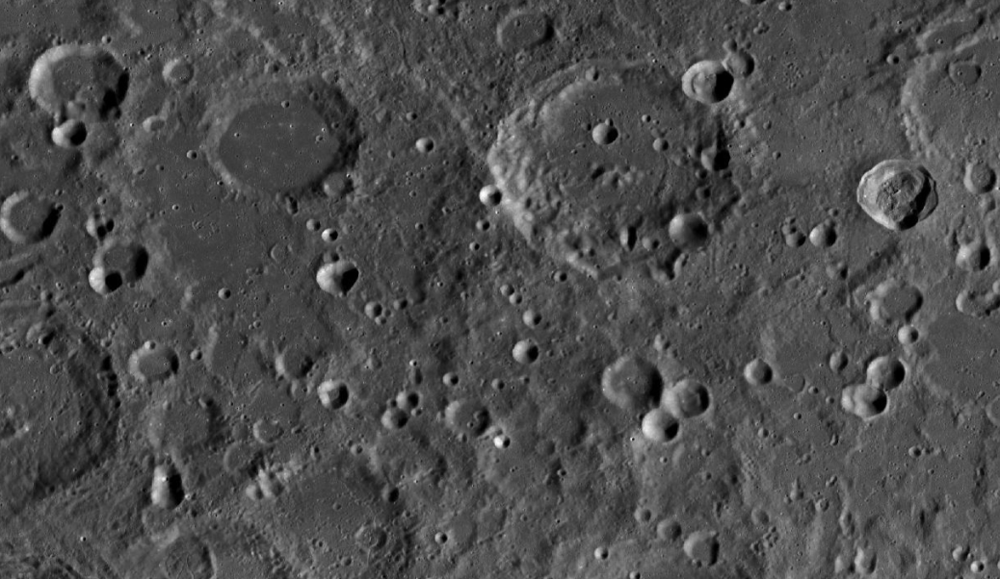

# Interactive Simulation Hub

Interactive Simulation Hub, etkileşimli simülasyonlar, 3D görselleştirme, rota planlama, görev kontrol arayüzleri ve destekleyici backend katmanlarını tek bir `pnpm workspace` altında toplayan bir monorepo yapısıdır.

Bu repo içindeki ana proje, Ay yüzeyinde görev yapan bir rover'ı simüle eden `moon-rover` uygulamasıdır. Uygulama; rota üretimi, çevresel risk değerlendirmesi, waypoint tabanlı görev akışı, kamera ve sahne yönetimi gibi konuları tek bir arayüzde birleştirir.

Canlı yayın hedefi:

- GitHub Pages: `https://ugurfurkanyesil-rgb.github.io/final/`



## Martian Map — NASA Space Apps 2026 (`mars-marswalk` branch)

*Interplanetary Survival Guide: Martian Map* challenge'ı için uygulama gerçek Mars
arazisinde çalışacak şekilde genişletildi. Varsayılan site Jezero Krateri; grid,
Perseverance'ın iniş noktası **Octavia E. Butler Landing** (18.44°K, 77.45°D)
üzerinde merkezlenir.

| Mod | URL | Arazi kaynağı |
|---|---|---|
| Mars (DEM) | `/?site=jezero` (varsayılan) | `public/sites/jezero/` — gerçek HiRISE DTM |
| Ay (prosedürel) | `/?site=moon` | Eski prosedürel arazi, davranışı değişmedi |

DEM verisi bulunamazsa uygulama prosedürel moda düşer ve sol altta nedenini gösterir.

### 1. Arazi verisini üret (bir kez)

```bash
pip install -r pipeline/requirements.txt
python pipeline/build_site.py            # Jezero, 512×512 grid, 4 m → ~2 km alan
```

Script, [USGS Mars 2020 TRN HiRISE DTM mozaiğinden](https://astrogeology.usgs.gov/search/map/mars_2020_terrain_relative_navigation_hirise_dtm_mosaic)
(1 m/piksel, 1.8 GB GeoTIFF) yalnızca gereken bölgeyi HTTP aralık istekleriyle okur ve
`artifacts/moon-rover/public/sites/jezero/` altına `grid.bin`, `meta.json` ve
`preview.png` yazar. Uzaktan okuma yavaşsa dosyayı indirip yerel yolu verin:

```bash
python pipeline/build_site.py --src JEZ_hirise_soc_006_DTM_MOLAtopography_DeltaGeoid_1m_Eqc_latTs0_lon0_blend40.tif
```

Seçenekler: `--grid` (düğüm sayısı), `--cell` (m), `--lat/--lon` (merkez). Üretilen
dosyaları (~1 MB) commit edin; GitHub Pages yayını bunları kullanır.

**Projeksiyon:** Kaynak DTM equirectangular (`lat_ts=0`). Bu projeksiyonda Jezero
enleminde doğu-batı ölçeği ~%5 şişer. Pipeline veriyi merkezde gerçek ölçekli
yerel projeksiyona yeniden örnekler, böylece eğimler doğru hesaplanır.

**Atıf:** USGS Astrogeology (2020), *Mars 2020 Terrain Relative Navigation HiRISE
DTM Mosaic*, [doi:10.5066/P9REJ9JN](https://doi.org/10.5066/P9REJ9JN); Fergason vd.
(2020), 51st LPSC.

### 2. DEM modunda ne değişti

- Krater listesi ve rastgele kaya/enkaz yok; arazi tamamen veriden gelir.
- Geçilmez bölgeler eğim eşiğinden türetilir (`src/config/marswalkProfile.js`).

### 3. Marswalk modeli (fiziksel maliyet)

Rota maliyeti artık **yürüme süresi [s]**. A*'ın her kenarı, o kenarı yürümenin
süresidir; yokuş yukarı ve aşağı farklıdır. Heuristic `mesafe / en yüksek hız`,
yani kabul edilebilir: A* en kısa süreli yolu garanti eder (testle Dijkstra'ya karşı doğrulanır).

| Parametre | Değer | Kaynak |
|---|---|---|
| Yürünebilir en dik eğim | 20° | NASA xEVA ConOps (EVA-EXP-0042 Rev B) §4.2.1.3 |
| Düz zemin yürüme hızı | ~2 km/h (TBR) | aynı doküman §4.2.1.3.1.1 |
| EVA süresi (plan bütçesi) | ≤ 8 sa | aynı doküman §4.1.4 |
| Başlangıçtan en uzak mesafe | ≤ 2 km | aynı doküman §4.2.1.3.1 |
| Eğimin hıza etkisi | Tobler (1993) şekli, düz zemin 2 km/h'ye ölçekli | **Varsayım** — NASA verisi bulunamadı |

**Kısıt:** Bu değerler Ay için yazılmıştır. NASA'nın skafandrlı 10 km yürüme testi
(NASA/TP-2009-214796) Mars yerçekiminde (3/8 g) geri yürüyüşü kabul edilemez bulmuştur;
değerler Mars için iyimserdir. Arayüz bunu gösterir.

Rota kartları her mod için gidiş ve gidiş-dönüş süresi, EVA bütçesi kullanımı,
maksimum eğim, dik zemin payı, tırmanış/iniş ve **GO/NO-GO** kararını gösterir. Modlar
(FAST / SAFE / ECO / AUTO) yalnızca yol seçimini etkileyen tercih ağırlıklarıdır;
raporlanan süreler hepsinde aynı fiziksel modelle hesaplanır.

### 4. Geri dönüş garantisi (walk-back margin)

Başlangıç noktası "ev" kabul edilir. Haritadaki her hücre için iki tam Dijkstra
hesaplanır: evden oraya ve oradan eve en hızlı yürüme süresi (yöne bağlı).
Rota boyunca her noktada `bütçe − (geçen süre + oradan eve en hızlı dönüş)`
**geri dönüş payı** hesaplanır; payın ilk negatif olduğu yer **dönüşü olmayan
nokta**dır ve 3D sahnede/mini haritada kırmızı işaretle gösterilir. GO kararı
bu payın rota boyunca hiç negatife düşmemesini şart koşar. `EVA Range` ısı
haritası gidip-dönülebilen bölgeyi gösterir.

### 5. Koşullar: Mars güneşi ve gölgeler

DEM modunda panelde **Mars Time** bölümü var: tarih + EVA başlangıcının yerel gerçek
güneş saati (LTST). Güneş konumu NASA GISS **Mars24** algoritmasıyla hesaplanır
(Allison & McEwen 2000); 3D ışık, gökyüzü ve `Illumination` ısı haritası (arazi
gölgeleri dahil) bundan gelir. Doğrulama: USGS `plio` test değerleri (GISS örneği),
`marstime` referansı ile 60 rastgele anda birebir uyum, azimut için bağımsız vektör
geometrisi testi (`tests/marsTime.test.mjs`).

Rota kartları, rotanın **yürüneceği saatteki** güneşe göre gölgede/karanlıkta geçen
süre oranını ve gün batımından önce eve dönülüp dönülmediğini gösterir. Bu bilgi
GO kararına katılmaz (Mars için kaynaklı bir gün ışığı kuralı bulunamadı).

Sınırlar: gölgeyi yalnızca site grid'indeki arazi düşürür (~20 km uzaktaki krater
duvarı modellenmez); doğuş/batış disk merkezine göre, kırılma yok.

### 5b. Hava sıcaklığı (Perseverance MEDA)

```bash
python pipeline/build_climate.py      # 22.7 MB indirir (bir kez), climate.json üretir (~185 KB)
```

Jezero'da 1.45 m'de ölçülen hava sıcaklıklarından (MEDA ATS, 5 dk ortalamalar,
sol 16–700) 10°'lik Ls dilimi × 5 dk'lık LTST dilimi için medyan ve %10–90 değerleri
çıkarılır. Mars Time paneli günlük eğriyi ve EVA başlangıcını, rota kartları EVA
boyunca beklenen sıcaklık aralığını gösterir (bilgi amaçlı, GO'ya girmez).

**Atıf (CC BY 4.0):** Hueso, R., Munguira, A., Sánchez-Lavega, A., de la Torre-Juárez, M.,
Rodríguez-Manfredi, J. A., Lepinette, A., Vicente-Retortillo, Á., Lemmon, M. (2024).
*Derived environmental temperatures at Jezero crater from Air Temperature Sensors'
measurements on the Perseverance rover* (v2). Zenodo.
[doi:10.5281/zenodo.11198655](https://doi.org/10.5281/zenodo.11198655) — Munguira et al. (2024), JGR Planets.

Aynı paketteki gün batımı tablosu, Mars24 hesabını bağımsız doğrulamak için de
kullanılır: 700 solda en büyük fark 0.25 dk.

Testler: `node --test artifacts/moon-rover/tests/*.test.mjs` (climate.json üretildiyse
gerçek veri bütünlüğü testi de çalışır)

### 6. Bilim durakları ve EVA optimizasyonu

```bash
python pipeline/build_geology.py      # 3.5 MB shapefile indirir (bir kez), geology.json üretir (~55 KB)
python -m unittest discover pipeline/tests
```

Mars 2020 bilim ekibinin fotojeoloji haritası (yüzey + ana kaya birimleri) site
grid'ine rasterleştirilir (çift-tek kuralı, hücre merkezinde örnek). **PLAN SCIENCE
EVA** düğmesi:

1. Her (yüzey, ana kaya) birim çifti için birimin *içindeki* (±2 hücre aynı birim)
   ve evden gidiş-dönüşü en kısa hücreyi, her ana kaya kontağı için en yakın kontak
   hücresini aday yapar (eve 20 m'den yakın, 2 km'den uzak, tek başına bütçeye
   sığmayan adaylar elenir; en yakın 12 aday kalır).
2. İkili yürüme sürelerini adaylardan Dijkstra ile hesaplar.
3. Alt küme DP'si (Held–Karp) ile **kesin** en iyi durak kümesini ve sırasını bulur:
   puan = örneklenen *farklı* etiketlerin toplamı (ana kaya 2, yüzey 1, kontak 3);
   kısıt = yürüme + durak süreleri ≤ EVA bütçesi. Eşit puanda en kısa toplam süre.
4. Durakları ev → duraklar → ev waypoint'lerine çevirip 4 modu planlar; durak
   süresi walk-back marjına ve toplam süreye eklenir.

**Varsayım / tasarım tercihi:** durak süresi (varsayılan 20 dk, panelden 5–60 dk)
ve puan ağırlıkları kaynaklı değildir; arayüzde böyle etiketlenir.

**Sınır:** 2 km'lik pencerede yalnızca 2 ana kaya birimi (Crater floor fractured 1 /
rough) ve 5 yüzey birimi var; çeşitlilik bu haritanın çözünürlüğüyle sınırlı.

**Atıf (CC BY 4.0):** Stack, K. M., Williams, N. R., Calef, F., et al. (2020).
*Photogeologic Map of the Perseverance Rover Field Site in Jezero Crater Constructed
by the Mars 2020 Science Team.* Space Science Reviews 216, 127.
[doi:10.1007/s11214-020-00739-x](https://doi.org/10.1007/s11214-020-00739-x)
(makale 18 Temmuz 2025 düzeltmesiyle CC BY 4.0). Veri: ek dosya
`11214_2020_739_MOESM3_ESM.zip`.

Doğrulama: optimizasyon 40 rastgele örnekte kaba kuvvetle aynı; rasterleştirme,
shapefile'dan farklı bir algoritmayla (düğüm başına nokta-poligon testi) bağımsız
hesaplanan birim alanları ve örnek hücrelerle karşılaştırılır (geology.json varsa).
- Sahne ölçeği (kamera, gölge, rota/işaret boyutu) alan boyutuna göre ayarlanır.
- Isı haritasına `Elevation` ve `No-Go` (A*'ın girmediği hücreler) katmanları eklendi.

## İçindekiler

- [Proje Özeti](#proje-özeti)
- [Neden Bu Proje?](#neden-bu-proje)
- [Öne Çıkan Özellikler](#öne-çıkan-özellikler)
- [Teknoloji Yığını](#teknoloji-yığını)
- [Monorepo Yapısı](#monorepo-yapısı)
- [Moon Rover Modülleri](#moon-rover-modülleri)
- [Kurulum](#kurulum)
- [Çalıştırma Komutları](#çalıştırma-komutları)
- [Geliştirme Akışı](#geliştirme-akışı)
- [Gelecek Geliştirmeler](#gelecek-geliştirmeler)
- [Lisans](#lisans)

## Proje Özeti

Bu repo, tek bir uygulamadan ibaret değildir. Amaç; simülasyon tarafını, API tarafını, ortak tipleri, veri şemalarını ve yardımcı scriptleri aynı geliştirme çatısı altında yönetmektir. Böylece hem frontend hem backend katmanları arasında daha tutarlı bir geliştirme süreci kurulabilir.

Özellikle `moon-rover` tarafı, şu başlıkları bir araya getirir:

- 3D ortamda rover hareketi
- Prosedürel arazi oluşturma
- Waypoint tabanlı rota planlama
- Risk, eğim ve aydınlatma gibi yüzey analizleri
- Kontrol paneli odaklı görev yönetimi
- Gelecekte genişletilebilir görev/sensör simülasyonları

## Neden Bu Proje?

Bu proje, sadece bir görsel demo değil; aynı zamanda aşağıdaki alanların birleşimini gösteren teknik bir çalışma niteliği taşır:

- gerçek zamanlı 3D arayüz geliştirme
- simülasyon mantığı ve hareket kontrolü
- veri odaklı görselleştirme
- çok paketli monorepo organizasyonu
- ortak API ve tip üretim akışı

Bir başka deyişle bu repo, hem ürünleşebilecek bir arayüz prototipi hem de güçlü bir teknik portföy projesi olarak değerlendirilebilir.

## Öne Çıkan Özellikler

### Moon Rover Simülasyonu

- React, Vite ve Three.js tabanlı etkileşimli 3D sahne
- React Three Fiber ile gerçek zamanlı render altyapısı
- Detaylı rover modeli ve hareket kontrolü
- Ay yüzeyi benzeri prosedürel terrain üretimi
- Waypoint seçimi ve rota planlama akışı
- Sağ panel üzerinden görev yönetimi ve mini-map etkileşimi
- Kamera modu ve sahne gözlemi

### Analiz ve Planlama

- eğim tabanlı değerlendirme
- hazard/risk yaklaşımı
- aydınlatma etkisini hesaba katan planlama mantığı
- alternatif rota modları üzerinden karar desteği
- görev sırasında görselleştirilmiş analiz çıktıları

### Monorepo Avantajları

- frontend, backend ve ortak kütüphanelerin tek repoda toplanması
- yeniden kullanılabilir API istemcileri
- OpenAPI tanımından üretilebilen tip ve şema katmanı
- ölçeklenebilir paket yapısı

## Teknoloji Yığını

Bu repoda kullanılan temel araçlar ve kütüphaneler:

- Node.js
- pnpm workspaces
- TypeScript
- React
- Vite
- Three.js
- React Three Fiber
- Express 5
- Drizzle ORM
- Zod
- OpenAPI / Orval

## Monorepo Yapısı

```text
Interactive-Simulation-Hub/
├── artifacts/
│   ├── api-server/         # Express tabanlı API sunucusu
│   ├── mockup-sandbox/     # UI / mockup denemeleri
│   └── moon-rover/         # 3D Moon Rover simülasyonu
├── attached_assets/        # Görseller, veri dosyaları, yardımcı içerikler
├── lib/
│   ├── api-client-react/   # Üretilmiş API istemci katmanı
│   ├── api-spec/           # OpenAPI tanımı ve codegen ayarları
│   └── api-zod/            # Zod şema üretimi
├── db/                     # Drizzle yapılandırması ve veri katmanı
├── scripts/                # Yardımcı scriptler ve araçlar
├── package.json
├── pnpm-lock.yaml
└── pnpm-workspace.yaml
```

## Moon Rover Modülleri

`artifacts/moon-rover` bu reponun merkezinde yer alır. Aşağıdaki ana parçalardan oluşur:

### 1. Uygulama Orkestrasyonu

Ana akış `src/App.jsx` içinde yönetilir.

Burada genel olarak:

- rover state yönetimi
- waypoint akışı
- rota planlama tetikleme
- görev logları
- toast bildirimleri
- kamera davranışları
- dust hazard ve görev durumu gibi ek simülasyon mantıkları

yürütülür.

### 2. 3D Sahne Katmanı

`src/components/MoonScene.jsx`, React Three Fiber tabanlı sahne bileşenidir.

Bu bölümde:

- terrain mesh oluşturma
- rover render işlemleri
- rota çizimleri
- güneş/aydınlatma etkisi
- tekerlek izleri
- toz efektleri
- sahne içi yardımcı nesneler

yer alır.

### 3. Görev Kontrol Paneli

`src/components/RightPanel.jsx`, kullanıcı etkileşiminin önemli bir bölümünü taşır.

Panel üzerinden:

- mini-map etkileşimi
- waypoint yerleştirme
- rota modu seçimi
- heatmap görüntüleme
- görev kontrolü
- durum ve analiz görünümü

yapılır.

### 4. Pathfinder

`src/utils/pathfinder.js`, rota üretimi için temel planlama katmanıdır.

Burada:

- world/grid dönüşümleri
- maliyet haritaları
- engel ve krater etkileri
- aydınlatma etkisi
- A* tabanlı arama mantığı

gibi hesaplamalar bulunur.

### 5. Arazi ve Görselleştirme Yardımcıları

Repo içinde terrain üretimi, heatmap üretimi, öğrenme modeli ve yardımcı görselleştirme fonksiyonları ayrı modüller halinde düzenlenmiştir. Bu yapı yeni sensör katmanları, yeni görev türleri veya farklı simülasyon modları eklemeyi kolaylaştırır.

## Ek Görsel

Aşağıdaki görsel, projenin tematik yönünü ve lunar yüzey estetiğini destekleyen repodaki görsel kaynaklardan biridir:


## Kurulum

Projeyi yerel ortamda çalıştırmak için önce bağımlılıkları yükleyin:

```bash
pnpm install
```

Not:

- Repo, `pnpm` ile kullanılacak şekilde yapılandırılmıştır.
- Kök `package.json` içinde farklı paket yöneticilerini engelleyen bir kontrol bulunur.

## Çalıştırma Komutları

### Moon Rover geliştirme sunucusu

```bash
pnpm --filter moon-rover dev
```

### Moon Rover production build

```bash
pnpm --filter moon-rover build
```

### Workspace genel typecheck

```bash
pnpm run typecheck
```

### Workspace genel build

```bash
pnpm run build
```

## Geliştirme Akışı

Bu repo ile çalışırken önerilen akış:

1. `pnpm install` ile bağımlılıkları yükle.
2. `pnpm --filter moon-rover dev` ile ana uygulamayı ayağa kaldır.
3. Simülasyon mantığı için `artifacts/moon-rover/src` altındaki bileşenleri geliştir.
4. API tarafı gerekiyorsa `artifacts/api-server` ve `lib` altındaki paketleri güncelle.
5. Değişiklikleri doğrulamak için `pnpm run typecheck` ve ilgili build komutlarını çalıştır.

## Bu Repo Ne İçin Uygun?

Bu proje özellikle şu amaçlar için güçlü bir temel sunar:

- portföy projesi olarak sunum
- araştırma / prototip amaçlı rover simülasyonu
- interaktif 3D dashboard geliştirme
- görev planlama arayüzleri tasarlama
- monorepo mimarisi ile çok paketli frontend/backend geliştirme

## Gelecek Geliştirmeler

Projede ileride geliştirilebilecek alanlar:

- daha gelişmiş görev senaryoları
- rover sensör paketleri
- veri kaydı ve replay sistemi
- çoklu görev ve çoklu araç desteği
- backend ile gerçek zamanlı senkronizasyon
- daha detaylı fizik ve yüzey etkileşimleri

## Lisans

Bu proje `MIT` lisansı ile işaretlenmiştir.
