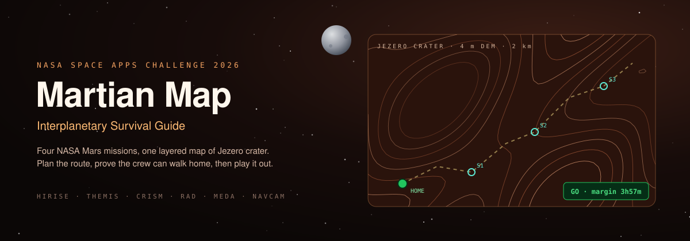
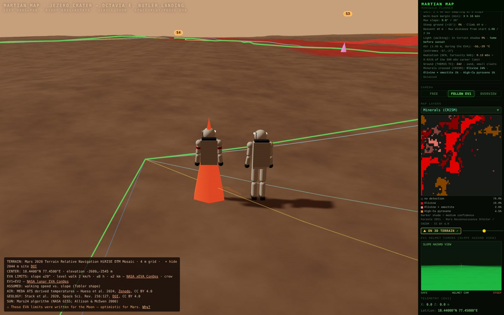
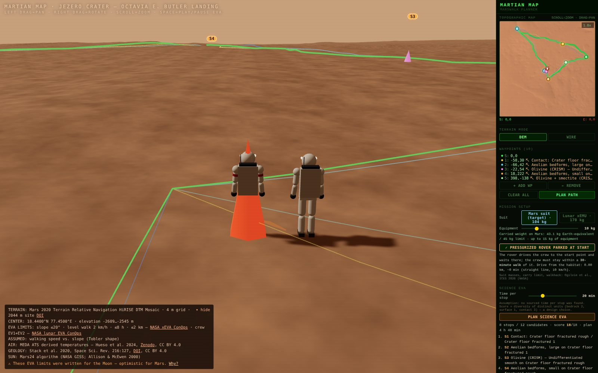

<p align="center">
  <a href="https://sayko89.github.io/nasa-space-apps-challenge-2026/"></a>
</p>

<p align="center">
  <a href="https://sayko89.github.io/nasa-space-apps-challenge-2026/"></a>
  
  
  <a href="https://github.com/sayko89/nasa-space-apps-challenge-2026/actions/workflows/deploy-pages.yml"></a>
</p>

<p align="center"><b>Team PERIAPSIS</b> · NASA Space Apps Challenge 2026 · <i>Interplanetary Survival Guide: Martian Map</i></p>

---

The first people to walk on Mars will want the best map possible. **Martian Map** is that map for one real place: the floor of **Jezero crater** around the Perseverance landing site. It layers data from **four NASA Mars missions** into a single 3D view, plans a two-person **Marswalk** that visits the most interesting rocks and minerals, proves at every step that the crew can still walk home (or back to their rover), and then plays the whole EVA out on a mission clock.

> **Why another Mars map?** Tools like JPL's Mars Trek and the USGS–NASA geologic maps layer data over the whole planet, at regional scale. An astronaut on a single Marswalk needs the opposite: one 2 km × 2 km area, every layer on the same **4 m grid**, rocks picked out at **1 m**, and a plan that says *where to walk, what to sample, and when to turn back*. Martian Map is built for that hyperlocal scale.


## Try it

| | |
|---|---|
| **Online** | **[sayko89.github.io/nasa-space-apps-challenge-2026](https://sayko89.github.io/nasa-space-apps-challenge-2026/)** — nothing to install |
| **Offline** | **Code → Download ZIP** → unzip → `MartianMap/Start-Windows.bat` (Windows) or `MartianMap/start-mac-linux.sh` (macOS / Linux). Needs only Python 3. |
| **From source** | `pnpm install`, then `pnpm dev` (tests: `pnpm test`) |

**Quick tour:** set the suit, equipment and rover in **Mission setup** → **PLAN SCIENCE EVA** → open **ground view** on a stop to see it through Perseverance's cameras → pick a route (SAFE / ECO / FAST / AUTO) and read its GO / NO-GO card → **START EVA** (×1 … ×600, **ABORT EVA**, **SIMULATE DUST DEVIL**) → **Map Layers → DRAPE ON 3D TERRAIN** for minerals, thermal inertia, rocks, geology or slope.

## How it answers the challenge

| The challenge asks for… | In Martian Map |
|---|---|
| A layered, integrated view of a location or route, from **multiple NASA science missions** | One 2 km × 2 km site at 4 m resolution; every layer is resampled onto the same grid: **MRO** (HiRISE terrain, CRISM minerals), **Mars Odyssey** (THEMIS thermal inertia), **Mars 2020** (geology map, MEDA air temperature, Navcam / Mastcam-Z images, rover traverse), **Curiosity** (RAD radiation) |
| **At least three kinds of data** | **Topographic** (HiRISE DTM, rock relief), **thermal** (THEMIS), **spectral** (CRISM), **geologic** (Mars 2020 map), **atmospheric** (MEDA), **radiation** (RAD + DONKI space weather), **optical** (Navcam, Mastcam-Z) |
| Identify a **science objective** and a location | Sample as many distinct bedrock and surface units, contacts and **CRISM minerals** (olivine, olivine–smectite, pyroxene on this site) as an 8-hour EVA allows, on the crater floor Perseverance landed on |
| **Astronaut safety first**; space weather, radiation | Per-route **GCR dose** vs the 600 mSv NASA career limit, a **DONKI space-weather advisory** (solar particle event within ±2 days → postpone), walk-back margin and point of no return, sunset and terrain shadow, expected air temperature |
| Spacesuits and **carried equipment** affect mobility | **Mission setup**: Mars suit (104 kg) or lunar xEMU (170 kg) plus equipment; the carried weight on Mars must stay under NASA's 45 kg Earth-equivalent limit, or the plan is NO-GO |
| A **route map** that **avoids obstacles such as large rocks** | A* on walking time; slopes above 20° and **rock outcrops / boulders** found in the 1 m HiRISE DTM are walls |
| **Rovers** to transport the crew; astronauts **in pairs** | **Pressurized rover as safe haven**: the crew may never be more than a 30-minute walk from it; a two-person crew (EV1 + EV2) walks the plan |
| **Point-of-view images** so the astronaut knows what to expect | **Ground view** on every science stop: the Perseverance Navcam / Mastcam-Z frames taken from the rover position closest to it, facing the stop |
| A format crews could use: habitat display, tablet, **HUD** | Planning view for the habitat, and an EVA **HUD** with mission clock, live walk-back margin, distance home, sun, temperature and dose |
| A time frame | Pick any date and local solar time: sun, shadows, temperature climatology and DONKI events follow it |

## The layers — all real data

| Layer | Data type | Mission / source | Used for |
|---|---|---|---|
| Terrain, 4 m grid over 2 km | topographic | MRO HiRISE — USGS Mars 2020 TRN DTM mosaic | slope walls, walking time, shadows |
| Rock relief | topographic | same DTM at 1 m: relief left in each 4 m cell after removing its slope | boulders / outcrops become walls; route card |
| Thermal inertia | thermal | Mars Odyssey THEMIS — Edwards & Buz (2021) | ground type along the route (dust, sand, rock) |
| Dominant minerals | spectral | MRO CRISM — Parente et al. (2021) | science stops (one per mineral), map layer |
| Surface + bedrock units | geologic | Mars 2020 science-team photogeologic map — Stack et al. (2020) | science stops, map layer |
| Air temperature at 1.45 m | atmospheric | Perseverance MEDA, one Mars year — Hueso et al. (2024) | temperature at the time the crew walks |
| Surface radiation | radiation | Curiosity RAD — Hassler et al. (2014): 0.64 mSv/day | EVA dose, HUD |
| Space weather | radiation | NASA DONKI (looked up live for the EVA date): solar particle events, CMEs modelled to reach Mars, X-class flares | go / postpone advisory for the date |
| Ground-level images | optical | Perseverance raw-image feed: 947 near-horizontal Navcam / Mastcam-Z frames from 97 rover positions in the site, with pointing | ground view at stops |
| Sun, local solar time | — | Mars24 algorithm (NASA GISS) | light, shadow, darkness, mission clock |
| EVA limits | — | NASA xEVA System ConOps: 20° slope, ~2 km/h, ≤ 8 h, ≤ 2 km | walls, speed, budget, radius |
| Suit mass, carry limit, rover walkback | — | NASA Mars suit study — Ogilvie et al. (ICES 2026) | mission setup, GO checks |





## How a Marswalk is planned

1. **Science stops.** Candidates are the nearest interior point of every geologic unit pair, every bedrock contact and every CRISM mineral within reach. Pairwise walking times come from Dijkstra; an exact subset DP (Held–Karp) picks the set and order of stops that samples the most distinct units and minerals while walking + time at stops fits the 8 h budget (and the rover's 30-minute reach, if used).
2. **Routes.** A* on walking time: Tobler's slope–speed shape scaled to NASA's ~2 km/h level pace; cells steeper than 20° or with more than 0.5 m of rock relief are walls. Four route preferences (SAFE, ECO, FAST, AUTO); times always use the same physical model.
3. **Walk-back margin.** At every point: *margin = budget − (time so far + fastest walk home)*. The first point with a negative margin is the **point of no return**.
4. **GO / NO-GO.** GO only if the margin never goes negative, the crew never goes beyond 2 km (or a 30-minute walk from the rover), no slope is above 20° and the suit plus equipment is light enough to carry.
5. **Conditions.** For the moment the crew actually walks each point: sun elevation, terrain shadow, darkness, home before sunset or not, expected air temperature, radiation dose and space-weather events.

## How it is carried out — EVA playback

- Two astronauts walk the plan on a mission clock (×1 … ×600). Positions come from the planner's own timeline, so what you see is exactly what the GO decision was based on.
- At each stop EV1 kneels and samples while EV2 documents; a flag marks every sampled stop.
- The HUD shows mission elapsed time, the current activity, the **live walk-back margin**, distance from the habitat, the sun, the MEDA temperature and the **radiation dose so far**.
- **ABORT EVA** sends the crew home on the fastest path; a **dust devil** on the route within the next 10 minutes of walking triggers an automatic abort.


## Verified, not just drawn

`node --test web/tests/*.test.mjs` and `python -m unittest discover pipeline/tests`, run on every push before the demo is deployed:

- **Sun:** USGS reference values, 60 random epochs against `marstime`, an independent vector check and the MEDA team's sunset table (largest difference 0.25 min over 700 sols).
- **Terrain & routes:** shadow length = height / tan(sun elevation); A* reaches the Dijkstra optimum in every mode; the walk-back maps equal A* times both ways.
- **Data:** `climate.json` and `geology.json` match independent recomputations from the original files.
- **Planning & playback:** the stop optimiser equals brute force on 40 random cases; mineral stops are found and scored; the playback timeline equals the planner's round trip; the abort path time equals the Dijkstra return time.
- **Safety numbers:** GCR dose scaling, the SEP advisory window, the suit carry limit (Mars suit passes, xEMU fails) and the rover drive estimate.

## Honest limits

- The EVA limits are lunar values; NASA found a suited walk-back at Mars gravity not acceptable (TP-2009-214796), so they are optimistic for Mars. The app says so.
- The RAD dose rate was measured at Gale crater, about 1.8 km lower than Jezero; with less atmosphere above it, the real dose at Jezero is likely a little higher.
- How slope changes suited walking speed is an assumption (Tobler shape). Time per stop, science-score weights, the 0.5 m rock-relief limit, the ±2-day SEP window and the 10 km/h rover speed are design choices, labelled as such in the app.
- A 1 m DTM shows rocks of a few metres, not smaller ones. Jezero's landing area was chosen for being smooth, so on this site only a handful of cells exceed the 0.5 m rock-relief limit; the layer matters more on rougher terrain. CRISM mineral names are the closest match of each spectral class. Thermal-inertia classes are guidance.
- Temperatures are a one-Mars-year climatology, not a forecast. DONKI covers past dates and is queried live from api.nasa.gov with the public demo key (rate-limited); for a future EVA, or when the lookup fails, the advisory says there is no data.
- Ground-view frame directions are mast azimuth + rover heading, accurate to a few degrees. Only the metadata is stored; the images load from mars.nasa.gov.

## Data & credits

- USGS Astrogeology (2020). *Mars 2020 Terrain Relative Navigation HiRISE DTM Mosaic.* [doi:10.5066/P9REJ9JN](https://doi.org/10.5066/P9REJ9JN)
- Edwards, C. S. & Buz, J. (2021). *THEMIS-derived Thermal Inertia of Jezero Crater, Mars.* Zenodo. [doi:10.5281/zenodo.4931348](https://doi.org/10.5281/zenodo.4931348) (CC BY 4.0)
- Parente, M., Saranathan, A. M., Itoh, Y., Tarnas, J. D., Seelos, F. P., Mustard, J. F. (2021). *Map of the dominant mineralogy over and around the Mars2020 landing ellipse.* Zenodo. [doi:10.5281/zenodo.5575824](https://doi.org/10.5281/zenodo.5575824) (CC BY 4.0)
- Stack, K. M., et al. (2020). *Photogeologic map of the Perseverance rover field site in Jezero crater.* Space Sci. Rev. 216, 127. [doi:10.1007/s11214-020-00739-x](https://doi.org/10.1007/s11214-020-00739-x) (CC BY 4.0)
- Hueso, R., et al. (2024). *Derived environmental temperatures at Jezero crater from the Perseverance Air Temperature Sensors* (v2). Zenodo. [doi:10.5281/zenodo.11198655](https://doi.org/10.5281/zenodo.11198655) (CC BY 4.0)
- Hassler, D. M., et al. (2014). *Mars' surface radiation environment measured with the Mars Science Laboratory's Curiosity rover.* Science 343, 1244797. [doi:10.1126/science.1244797](https://doi.org/10.1126/science.1244797)
- NASA Community Coordinated Modeling Center. *DONKI — Space Weather Database Of Notifications, Knowledge, Information.* [kauai.ccmc.gsfc.nasa.gov/DONKI](https://kauai.ccmc.gsfc.nasa.gov/DONKI/)
- NASA/JPL-Caltech. Mars 2020 Perseverance raw images (Navcam, Mastcam-Z) and rover waypoints (MMGIS).
- Ogilvie, R., et al. (2026). *Mars Spacesuit Mass Requirements.* ICES-2026. [NASA NTRS 20260005410](https://ntrs.nasa.gov/citations/20260005410)
- NASA-STD-3001 Volume 1, Rev B (2022): career effective dose limit 600 mSv.
- Allison, M. & McEwen, M. (2000). Mars24 algorithm, NASA GISS. NASA EVA-EXP-0042 Rev B (2020), *Exploration EVA System ConOps*. NASA (2020), *EVA Lunar Surface ConOps*. Norcross, J., et al. (2009), NASA/TP-2009-214796. Tobler, W. (1993), NCGIA TR 93-1.

## Use of AI

Developed with AI assistance (Anthropic Claude) for code, data pipelines, tests and documentation, under the team's direction and review. All data come from the sources above. The astronauts, dust devil and other 3D objects are original procedural models written in code; no AI-generated images are used.

## Repository map

```
web/     the web app (React + Three.js / react-three-fiber, Vite)
  src/utils/              walkModel · pathfinder (A*) · walkback (Dijkstra) · science (stop optimiser)
                          radiation · marsTime (Mars24) · shadows · climate · evaTimeline + evaPlayback
  src/config/             marswalkProfile (EVA limits) · mission (suit, equipment, rover)
  src/components/         MoonScene (3D) · MarsCrew · EvaHud · RightPanel · PovViewer (ground view)
  public/sites/jezero/    grid.bin · geology · climate · layers (THEMIS, CRISM, rocks) · space_weather · pov
  tests/                  node --test suites
pipeline/                 fetch_sources · build_site · build_layers · build_space_weather · build_pov
                          build_climate · build_geology · build_offline
MartianMap/               ready-to-run offline package
```

`?site=moon` still opens the original procedural Moon rover simulator this project grew from (TUA Astro Hackathon).

## Rebuilding the data

The processed data are committed, so the app runs as is. Sources are fetched by GitHub Actions (`.github/workflows/fetch-sources.yml`, `fetch-dtm.yml`) into `pipeline/sources/`; then:

```bash
pip install -r pipeline/requirements.txt
python pipeline/build_layers.py         # THEMIS, CRISM, rock relief → layers.json
python pipeline/build_space_weather.py  # DONKI → space_weather.json
python pipeline/build_offline.py        # refresh MartianMap/app
```

## License

MIT for the code. Data keep their own licenses (CC BY 4.0 or public domain, listed above).
