<p align="center">
  <a href="https://sayko89.github.io/nasa-space-apps-challenge-2026/"></a>
</p>

<p align="center">
  <a href="https://sayko89.github.io/nasa-space-apps-challenge-2026/"></a>
  
  
  <a href="https://github.com/sayko89/nasa-space-apps-challenge-2026/actions/workflows/deploy-pages.yml"></a>
</p>

<p align="center"><b>Team PERIAPSIS</b> · NASA Space Apps Challenge 2026 · <i>Interplanetary Survival Guide: Martian Map</i></p>

---

The first people to walk on Mars will want the best map possible. **Martian Map** is that map for two real places where NASA rovers have worked: the floor of **Jezero crater** around the Perseverance landing site, and the **boxwork ridges of Mount Sharp** in Gale crater that Curiosity explored in 2025–26. It layers data from **four NASA Mars missions** into a single 3D view, plans a two-person **Marswalk** that visits the most interesting rocks, minerals and chemistry, proves at every step that the crew can still walk home (or back to their rover), plays the whole EVA out on a mission clock — re-planning a safe route on the spot when a dust devil crosses the way — and puts it on the astronaut's wrist as a **wrist console** and an Apollo-style printed **cuff card**. The work is split into four screens that follow a mission from start to finish: **01 EXPLORE → 02 ANALYZE → 03 PLAN MISSION → 04 OPERATIONS**.

> **Why another Mars map?** Tools like JPL's Mars Trek and the USGS–NASA geologic maps layer data over the whole planet, at regional scale. An astronaut on a single Marswalk needs the opposite: one 2 km × 2 km area, every layer on the same **4 m grid**, rocks picked out at **1 m**, and a plan that says *where to walk, what to sample, and when to turn back*. Martian Map is built for that hyperlocal scale.


## At a glance

| | |
|---|---|
| **Sites** | 2 — Jezero crater (Perseverance) and Mount Sharp boxwork, Gale crater (Curiosity) |
| **NASA missions** | 4 — Mars Reconnaissance Orbiter, Mars Odyssey, Mars 2020, Mars Science Laboratory |
| **Data types** | 8 — topographic, optical, thermal, spectral, geologic, chemical, atmospheric, radiation |
| **Resolution** | 4 m grid over 2 km × 2 km; rocks from 1 m DTMs; orbital image at 0.5 m/px |
| **Ground views** | 3,815 rover camera frames from 234 rover positions |
| **Mission objectives** | 5 per site — the chosen objective decides which stops the planner can pick ([table](#mission-objectives--the-plan-follows-the-objective)) |
| **Safety checks** | hard: walk-back margin and point of no return, slope, radius, carry weight, rover reach, daylight · environment: space weather, 30-min reserve, depressions / obstacle edges |
| **Decision** | **GO · CONDITIONAL · NO-GO · INSUFFICIENT DATA**, each with its reasons; missing data is never "safe" |
| **Oxygen & mass** | live O₂ use per NASA BVAD life-support scenario (0.076 / 0.15 / 1.0 kg/h), O₂ for the walk home + reserve, carried mass falling as O₂ is used ([details](#oxygen-and-carried-mass)) |
| **EVA assessment** | three separate results, no combined score: **A. Payload & Mass** · **B. Dust Exposure & Equipment Reliability** (qualitative, sourced) · **C. Terrain & Mobility** ([details](#suit-payload-and-dust--three-separate-assessments)) |
| **Hazard map** | slope and rock walls, obstacle buffer, closed depressions, steep / rough ground, rover reach, ground known only from orbit |
| **Dust devil during the EVA** | 25 m safety zone around it, a new **SAFE route to the destination** planned from the point where the crew sees it; only if none is safe, back to the start the way they came ([details](#dust-devil-on-the-route--a-new-safe-route-not-a-run-home)) |
| **Provenance** | every layer labelled direct measurement / orbital / derived / transferred reference / modelled / simulated / AI-predicted |
| **EVA limit sets** | Lunar ConOps (NASA) or **Mars conservative** (derived for Mars gravity) |
| **AI terrain segmentation** | soil / bedrock / sand / big rock on 445 rover Navcam frames, model trained on NASA/JPL AI4Mars — measured accuracy, never changes a route ([details](#mars-ai-terrain-segmentation--what-the-ground-in-the-rover-images-is)) |
| **3D terrain** | 4 m mesh lit by the **1 m HiRISE DTM** relief shading (×1 true, ×2 / ×4 emphasised), HiRISE image or elevation colours, data layers draped on top |
| **Interface** | four workspaces — **Explore · Analyze · Plan Mission · Operations** — with a data catalog, one inspector for every point / layer / stop / route, an EVA timeline band and a first-visit guide ([details](#the-interface--four-workspaces)) |
| **Outputs** | 3D planning view, live EVA HUD, **Martian EVA Cuff** wrist console, printable **cuff card + EVA backup checklist** (2 × A4 / PDF), JSON export, share link; works on desktop, tablet and phone |
| **Tests** | 175 JavaScript (incl. real-data runs of every objective on both sites, and Moon mode) + 11 Python + lint + README figure check on every push before deploy; browser tests (all four workspaces, desktop, tablet, phone, two-page cuff PDF, wrist console, Gale, Moon) in their own workflow; 12 Python tests for the segmentation pipeline in its own workflow |

## Try it

| | |
|---|---|
| **Online** | **[sayko89.github.io/nasa-space-apps-challenge-2026](https://sayko89.github.io/nasa-space-apps-challenge-2026/)** — nothing to install |
| **Offline** | **Code → Download ZIP** → unzip → `MartianMap/Start-Windows.bat` (Windows) or `MartianMap/start-mac-linux.sh` (macOS / Linux). Needs only Python 3. |
| **Jury deck** | [docs/Martian-Map-Jury-Deck.pdf](docs/Martian-Map-Jury-Deck.pdf) — the 7-slide project presentation |
| **From source** | `pnpm install`, then `pnpm dev` (tests: `pnpm test`; lint: `pnpm --filter martian-map lint`; browser tests after a build: `pnpm --filter martian-map e2e`) |

**First visit.** A short guide opens once: what Martian Map is, the four workspaces and a three-click quick start. It is always under **? GUIDE** in the top bar, and each workspace has a closed *How to use this screen* slot with its three steps. Long explanations (what a route mode optimises, why a decision is CONDITIONAL …) sit in closed slots that open with a click, so the screen stays readable.

**Quick start — three clicks**

1. **03 PLAN MISSION** → choose a mission objective → **PLAN SCIENCE EVA**.
2. Read the decision at the top right (**GO / CONDITIONAL / NO-GO / INSUFFICIENT DATA**) and open *Why?* for the reasons.
3. **04 OPERATIONS** → **START EVA** to watch the walk, **OPEN WRIST CONSOLE**, or **PRINT CUFF CARD**.

**The whole workflow — 13 steps.** The numbered strip at the top of the Plan Mission and Operations panels walks through the steps in order and shows the next one; each button opens the workspace that holds that step. A step counts as done only when its inputs are complete and current; changing an upstream setting re-opens the steps that depend on it.

| # | Step | Where | What you do |
|---:|---|---|---|
| 1 | **Mission objective** | 03 PLAN MISSION | choose one of the site's five; *PLAN SCIENCE EVA* stays locked until you do. Changing it later re-plans the stops |
| 2 | **Exploration site** | top bar | **JEZERO** or **MOUNT SHARP BOXWORK** (each site has its own objectives and layers) |
| 3 | **Crew & equipment** | 03 PLAN MISSION → mission configuration | suit, **EVA limits** (Lunar ConOps / Mars conservative), pressurized rover as safe haven, *keep 4 m from obstacles*, **oxygen** scenario, initial O₂ and reserve |
| 4 | **Payload & mass** | 03 PLAN MISSION | one equipment figure or an itemised payload; total, limit and remaining capacity |
| 5 | **Dust & equipment reliability** | 03 PLAN MISSION | the four dust protection settings (done when none is left "not specified") |
| 6 | **Data layers** | 01 EXPLORE · 02 ANALYZE | tick layers in the **data catalog** (several at once, each with its own opacity), **COMPARE LAYERS** swipe, **DRAPE ON 3D TERRAIN**; ⓘ or a click on the terrain opens the inspector |
| 7 | **Hazard assessment** | 02 ANALYZE | the **Hazards** layer |
| 8 | **Science stops** | 03 PLAN MISSION | *PLAN SCIENCE EVA*; open a stop for its card (why chosen, what to look at, evidence, risk, confidence), **ground view** or **chemistry** |
| 9 | **EVA route** | 03 PLAN MISSION | SAFE / ECO / FAST / AUTO — each with what it optimises, its cost and elevation profile — and the route comparison |
| 10 | **Terrain & mobility** | 04 OPERATIONS | part C of the EVA assessment under the decision |
| 11 | **GO / NO-GO** | 04 OPERATIONS | the mission summary, the decision with its reasons, and the three separate assessments |
| 12 | **EVA simulation** | 04 OPERATIONS | **START EVA** (×1 … ×600, **ABORT EVA**, **SIMULATE DUST DEVIL**), camera angle, helmet camera, **wrist console**; the HUD shows the decision, payload, dust and mobility status and the O₂ & mass panel |
| 13 | **Mission export & cuff card** | 04 OPERATIONS | **PRINT CUFF CARD** (page 1: objective, coordinates, stations with the direction home, hazards, equipment and dust warnings, data limits; page 2: EVA backup checklist), **EXPORT JSON** (objective, stop cards, decisions, assessments, provenance), **SHARE LINK** |

## The interface — four workspaces

The Mars sites open in four workspaces, one per stage of a mission. Switching keeps everything (plan, layers, EVA clock); only the layout changes, and every number still comes from the same planner. The top bar always shows the site and the mission status: objective · route · decision · EVA. Design notes and the NASA tools that inspired the layout (Mars Trek, RSVP, Playbook, Eyes): [`docs/WORKSPACES.md`](docs/WORKSPACES.md).

| Workspace | Left | Centre | Right panel, top to bottom |
|---|---|---|---|
| **01 EXPLORE** — look at the site and what each layer shows | data catalog | 3D terrain | inspector of the clicked point, site map, camera |
| **02 ANALYZE** — check the data the plan rests on, and what is missing | data catalog | 3D terrain | inspector, terrain analysis (layers, legend, compare, drape), scientific data available and missing, helmet camera, **Mars AI terrain segmentation**, provenance table |
| **03 PLAN MISSION** — set up the crew and plan the walk | — | 3D terrain + **EVA timeline** | **site map** → **waypoints** (mark points on the map) → **route modes** SAFE / ECO / FAST / AUTO → objective & science stops → route comparison → mission configuration |
| **04 OPERATIONS** — decide and run the EVA | — | 3D terrain + **EVA timeline** | **site map** → **dust devil drill** (SIMULATE DUST DEVIL, then click the map) → **START EVA** (the route chosen in Plan, not asked again) → **camera angle** (free / follow EV1 / overview) → **helmet camera** (image processing: elevation / slope view) → **Martian EVA Cuff** → mission summary & GO / NO-GO → telemetry, export, log |

- **Data catalog** — built from what the site actually loaded, by category (imagery, topography, geology, mineralogy, thermal, AI terrain segmentation, hazards, atmospheric, radiation). Tick a layer to drape it on the 3D terrain; several layers can be draped at once, each with its opacity and draw order; ⓘ opens its description and source.
- **Inspector** — one card for a map point (coordinates, elevation, slope, hazard, distance home, *add as waypoint* — or, on a cell the crew cannot walk, the reason instead of the button), a data layer, a science stop or a route, with tabs for overview, scientific evidence, data source, technical details and mission relevance.
- **EVA timeline** — walking legs, stops (S1, S2 …) and the walk home of the active route on one time axis, with the EVA budget, point of no return, sunset and oxygen limits; a cursor follows the EVA clock during playback, and a click on a stop opens it in the inspector.
- **3D view** — the follow camera frames both astronauts, EV1 and EV2, side by side and full height, so their position and posture are clear from the first second; *Overview* shows the whole route from above. The astronauts carry the team's Periapsis patch on their backpacks.
- **Readable on a screen across the room** — larger text across all panels, closed slots for long explanations, and status always written as a word next to its colour.

<table>
<tr>
<td width="50%">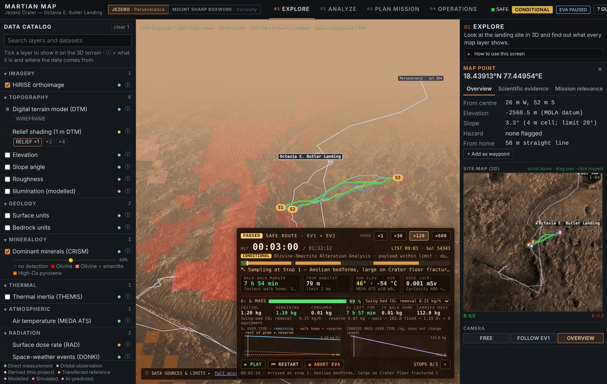</td>
<td width="50%">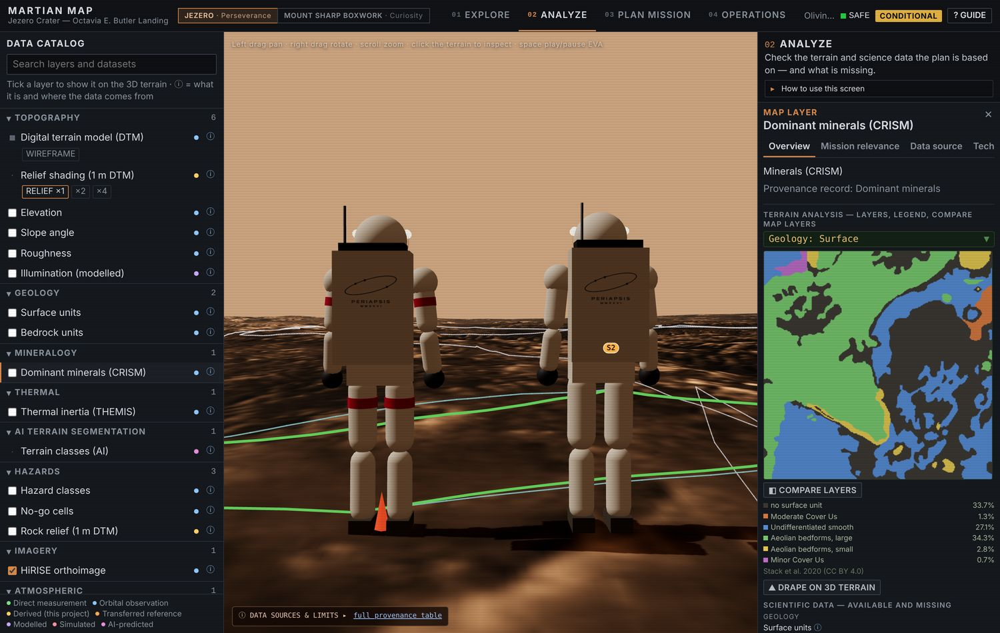</td>
</tr>
<tr><td align="center"><b>01 EXPLORE</b> — catalog, drapes, point inspector</td><td align="center"><b>02 ANALYZE</b> — layer inspector, terrain analysis</td></tr>
<tr>
<td width="50%">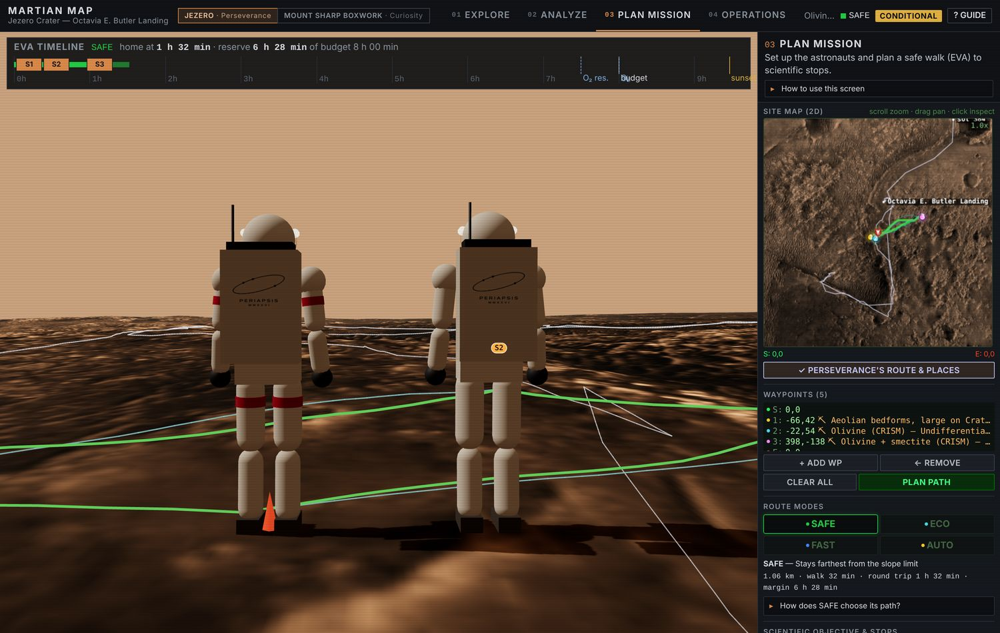</td>
<td width="50%"></td>
</tr>
<tr><td align="center"><b>03 PLAN MISSION</b> — map → waypoints → route modes</td><td align="center"><b>04 OPERATIONS</b> — map → dust devil drill → EVA → camera angle → helmet camera</td></tr>
</table>

## On a tablet or a phone

The same app adapts to the screen, so it can travel from the habitat display to a tablet or the crew's phone. The four workspaces stay in the top bar (short names on a tablet; their own row on a phone). On a phone the panel becomes a sheet under the 3D view, the 3D view takes touch gestures (drag = rotate, two fingers = pan / zoom, tap = inspect) and the EVA HUD shrinks to the four safety numbers.

<table>
<tr>
<td width="73%">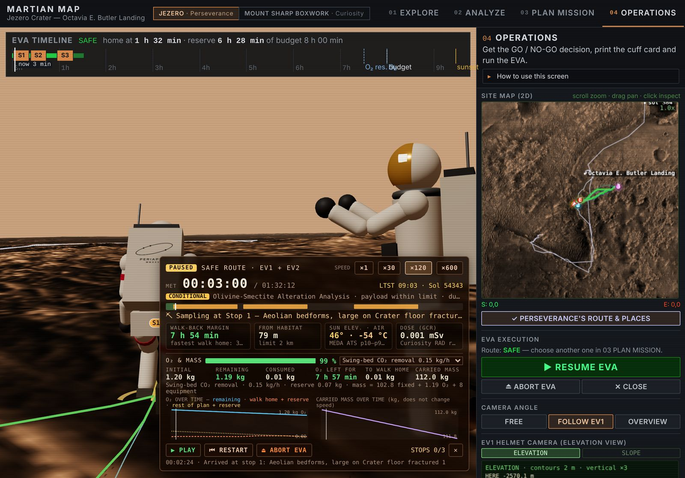</td>
<td width="27%">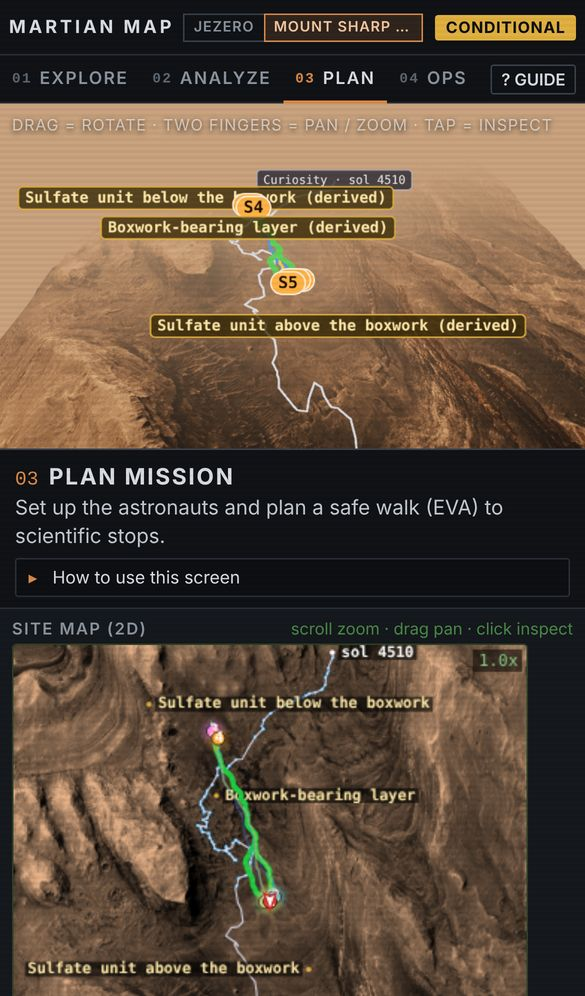</td>
</tr>
<tr><td align="center"><b>Tablet</b> — 04 OPERATIONS, EVA playback at Jezero</td><td align="center"><b>Phone</b> — 03 PLAN, a Gale EVA and the site map</td></tr>
</table>

## Two sites, one pipeline

<table>
<tr>
<td width="50%">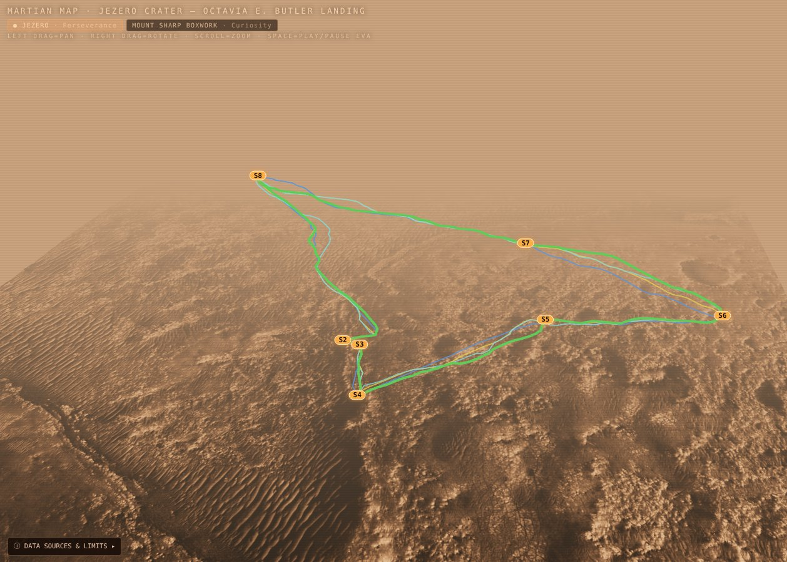</td>
<td width="50%"></td>
</tr>
<tr><td align="center"><b>Jezero crater</b> — 8-stop EVA on the crater floor</td><td align="center"><b>Mount Sharp boxwork, Gale</b> — a 6-stop EVA on the boxwork layer</td></tr>
</table>

| | Jezero crater | Mount Sharp boxwork, Gale crater |
|---|---|---|
| Rover that explored it | Perseverance (Mars 2020) | Curiosity (MSL) |
| Centre | 18.440° N, 77.450° E | 4.811° S, 137.384° E |
| Elevation in the site | −2609 … −2545 m (flat crater floor) | −3820 … −3350 m (steep, layered) |
| How the site was chosen | around the landing site | from Curiosity's own track during the boxwork campaign (sols 4541–4844) |
| Mission objectives (choose one) | lake & delta (partial: delta outside the site) · mineralogical diversity · bedrock & contacts · olivine & pyroxene · olivine–smectite alteration | boxwork ridges & hollows · geological contacts · chemical anomalies · water-related alteration · ChemCam target re-investigation |
| Ground views | 947 Navcam / Mastcam-Z frames, 97 positions | 2,868 Navcam / Mastcam frames, 137 positions |
| Example plan (SAFE, lunar limits, 09:00 LTST) | *Mineralogical Diversity*: <!--fig:jezero.lunar.mineral-diversity.example-->8 stops · 4.14 km · 4 h 46 min · tightest margin 3 h 14 min<!--/fig--> | *Geological Contact Exploration*: <!--fig:gale.lunar.contacts.example-->5 stops · 1.58 km · 2 h 36 min · tightest margin 5 h 24 min<!--/fig--> |

The second site came out of the same pipeline as the first: pick a centre, cut the 1 m DTM and the orbital image, build the 4 m grid, rock relief, units, chemistry, climate and ground views. That is the challenge's "tool or system that generates maps of different locations".

**Which data each site has**

| Layer | Data type | Jezero | Gale |
|---|---|:---:|:---:|
| Terrain (HiRISE DTM, 1 m → 4 m grid) | topographic | ✓ | ✓ |
| Rock relief from the 1 m DTM | topographic | ✓ | ✓ |
| Orbital image (HiRISE, 0.5 m/px) | optical | ✓ | ✓ |
| Rover ground views | optical | ✓ Perseverance | ✓ Curiosity |
| Geologic units | geologic | ✓ published map | ✓ derived (see [limits](#honest-limits)) |
| Dominant minerals (CRISM) | spectral | ✓ | — investigated, not available¹ |
| Thermal inertia (THEMIS) | thermal | ✓ | — investigated, not available¹ |
| Rock chemistry (ChemCam / SuperCam, PIXL) | chemical | — investigated, not available¹ | ✓ 233 targets |
| Air temperature climatology | atmospheric | ✓ MEDA | ✓ REMS |
| Surface radiation (RAD) | radiation | ✓ transferred from Gale | ✓ measured here |
| Space weather (DONKI) | radiation | ✓ | ✓ |

¹ Why, in the app's provenance table and under [Data provenance](#data-provenance): Gale's THEMIS product is a qualitative image without physical units; no processed CRISM mineral map of the Gale site was found; SuperCam compositions are supplementary CSV in the PDS Analyst's Notebook without target coordinates, and PIXL maps millimetre-scale patches. Missing layers are left empty — never filled in.

## Mission objectives — the plan follows the objective

A science EVA cannot be planned until an objective is chosen. The objective is not a label: it decides **which candidate stops exist** (unit interiors, contacts, CRISM classes, ChemCam standouts, measured ChemCam targets) and **what each is worth** to the Held–Karp optimiser (`web/src/config/objectives.js` → `utils/science.js`). Every objective records its purpose, scientific relevance with sources, data layers, candidate places, selection criteria and uncertainty; the tests check that each one points at unit, mineral and chemistry names that really exist in its site's data. Weights are design choices, shown with the objective.

**Jezero crater** — plans from the site centre, 09:00 LTST, SAFE route

| Objective | What becomes a stop | Lunar ConOps | Mars conservative |
|---|---|---|---|
| Ancient Lake and Delta Investigation *(partial)* | crater-floor bedrock interiors, their contacts, olivine + smectite; **the delta lies ~2 km west, outside the site** | <!--fig:jezero.lunar.lake-delta.row-->3 stops · 1.05 km · 1 h 32 min · margin 6 h 28 min<!--/fig--> | <!--fig:jezero.mars.lake-delta.row-->1 h 53 min · margin 5 h 37 min<!--/fig--> |
| Mineralogical Diversity Exploration | one spot per CRISM class present, units and contacts for context | <!--fig:jezero.lunar.mineral-diversity.row-->8 stops · 4.14 km · 4 h 46 min · margin 3 h 14 min<!--/fig--> | <!--fig:jezero.mars.mineral-diversity.row-->6 h 08 min · margin 1 h 21 min<!--/fig--> |
| Bedrock and Geological Contact Analysis | each bedrock unit's interior + the contact between them | <!--fig:jezero.lunar.bedrock-contacts.row-->3 stops · 0.19 km · 1 h 06 min · margin 6 h 54 min<!--/fig--> | <!--fig:jezero.mars.bedrock-contacts.row-->1 h 10 min · margin 6 h 20 min<!--/fig--> |
| Olivine and Pyroxene Investigation | CRISM olivine and high-Ca pyroxene (no low-Ca pyroxene in the site) | <!--fig:jezero.lunar.olivine-pyroxene.row-->3 stops · 1.47 km · 1 h 44 min · margin 6 h 16 min<!--/fig--> | <!--fig:jezero.mars.olivine-pyroxene.row-->2 h 13 min · margin 5 h 17 min<!--/fig--> |
| Olivine-Smectite Alteration Analysis | olivine + smectite next to plain olivine | <!--fig:jezero.lunar.olivine-smectite.row-->3 stops · 1.06 km · 1 h 32 min · margin 6 h 28 min<!--/fig--> | <!--fig:jezero.mars.olivine-smectite.row-->1 h 53 min · margin 5 h 36 min<!--/fig--> |

**Mount Sharp boxwork, Gale crater**

| Objective | What becomes a stop | Lunar ConOps | Mars conservative |
|---|---|---|---|
| Boxwork Ridge and Hollow Investigation | a ridge and a hollow inside the boxwork-bearing layer | <!--fig:gale.lunar.boxwork.row-->2 stops · 2.87 km · 2 h 19 min · margin 5 h 41 min<!--/fig--> | <!--fig:gale.mars.boxwork.row-->3 h 23 min · margin 4 h 06 min<!--/fig--> |
| Geological Contact Exploration | the layer's lower and upper contacts + each level's interior | <!--fig:gale.lunar.contacts.row-->5 stops · 1.58 km · 2 h 36 min · margin 5 h 24 min<!--/fig--> | <!--fig:gale.mars.contacts.row-->3 h 12 min · margin 4 h 18 min<!--/fig--> |
| Chemical Anomaly Investigation | the nearest rock for each kind of ChemCam standout (one stop per rock) | <!--fig:gale.lunar.chem-anomaly.row-->8 stops · 0.84 km · 3 h 10 min · margin 4 h 50 min<!--/fig--> | <!--fig:gale.mars.chem-anomaly.row-->3 h 29 min · margin 4 h 01 min<!--/fig--> |
| Water-Related Alteration Evidence | the nearest "CaO high" rock (calcium-sulfate veins), boxwork ridge and hollow | <!--fig:gale.lunar.water-alteration.row-->3 stops · 2.88 km · 2 h 39 min · margin 5 h 20 min<!--/fig--> | <!--fig:gale.mars.water-alteration.row-->3 h 44 min · margin 3 h 45 min<!--/fig--> |
| ChemCam Target Re-investigation | the ten nearest measured targets (targets in one 4 m cell share a stop) | <!--fig:gale.lunar.chemcam-revisit.row-->10 stops · 0.64 km · 3 h 43 min · margin 4 h 17 min<!--/fig--> | <!--fig:gale.mars.chemcam-revisit.row-->3 h 57 min · margin 3 h 33 min<!--/fig--> |

Every plan above passes all hard constraints. With the space weather unknown (a future date) each one is **CONDITIONAL**, not GO — see [the decision](#the-decision-go--conditional--no-go--insufficient-data).

Every chosen stop has a **stop card**: position (lat / lon and metres from the site centre), the objective, why it was chosen (the features it adds and their weights), what to investigate there, the evidence (units, CRISM class, ChemCam values against the layer mean), the data layers behind it, its terrain risk (from the planner's own slope and rock thresholds), its data confidence (measured / mapped / derived) and the objective's uncertainty.

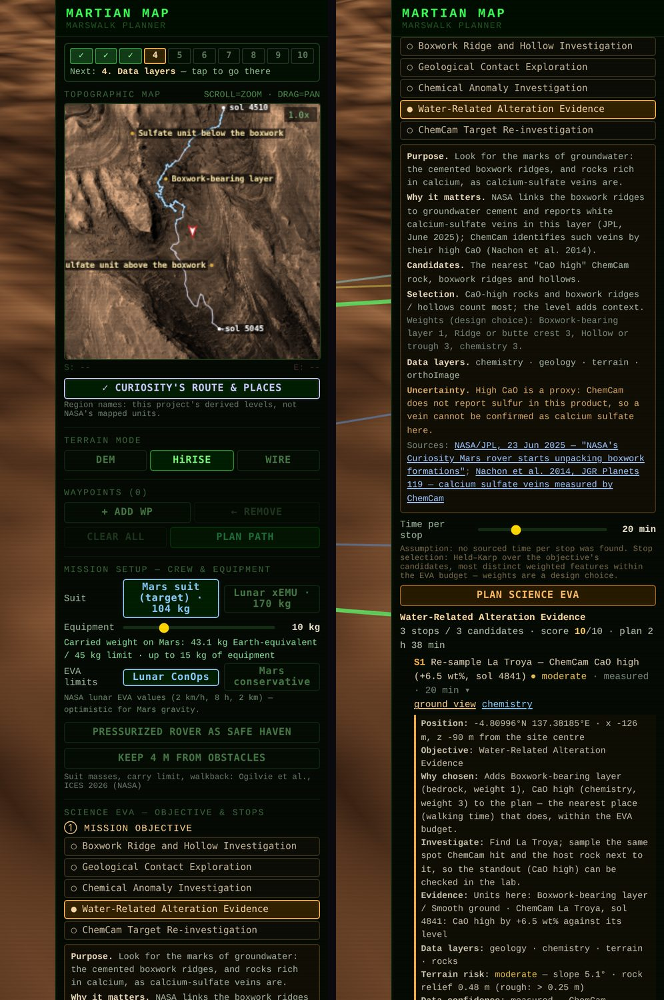

## How it answers the challenge

| The challenge asks for… | In Martian Map |
|---|---|
| A layered, integrated view of a location or route, from **multiple NASA science missions** | Two 2 km × 2 km sites at 4 m resolution; every layer is resampled onto the same grid: **MRO** (HiRISE terrain and images, CRISM minerals), **Mars Odyssey** (THEMIS thermal inertia), **Mars 2020** (geologic map, MEDA air temperature, Navcam / Mastcam-Z images, traverse), **Curiosity** (RAD radiation, REMS air temperature, ChemCam chemistry, Navcam / Mastcam images, traverse) |
| **At least three kinds of data** | Eight: **topographic** (HiRISE DTM, rock relief), **optical** (HiRISE orbital image, rover cameras), **thermal** (THEMIS), **spectral** (CRISM), **geologic** (Mars 2020 map; derived units at Gale), **chemical** (ChemCam), **atmospheric** (MEDA, REMS), **radiation** (RAD + DONKI space weather) |
| Identify a **science objective** and a location | Five selectable objectives per site that **change the planner's candidates and weights** — from Jezero's olivine–smectite alteration to Gale's boxwork ridges and ChemCam re-sampling; each with purpose, relevance and sources, and a card for every stop saying why it was chosen. The Gale site follows the challenge's own example: Curiosity's 2025 boxwork study on Mount Sharp |
| **Astronaut safety first**; space weather, radiation | A **dose-rate comparison** — Earth, ISS, Moon, Mars, all measured — so the crew sees why Mars is different; a **Mars-conservative EVA limit set**; walk-back margin and point of no return; per-route **GCR dose** vs the 600 mSv NASA career limit; **DONKI space-weather advisory** (solar particle event within ±2 days → postpone); **daylight** (home before sunset, or NO-GO); terrain shadow, expected air temperature. See [Safety first](#safety-first) |
| Spacesuits and **carried equipment** affect mobility | **Mission setup**: Mars suit (104 kg) or lunar xEMU (170 kg) plus equipment; the carried weight on Mars must stay under NASA's 45 kg Earth-equivalent limit, or the plan is NO-GO. **Mars conservative** limits slow the walk by the measured suited cost at Mars gravity |
| A **route map** that **avoids obstacles such as large rocks** | A* on walking time; slopes above 20° and **rock outcrops / boulders** found in the 1 m HiRISE DTM are walls; an optional **4 m buffer** inflates them; the **Hazards** layer adds closed depressions, steep and rough ground and ground known only from orbit. During the EVA a **dust devil** becomes a moving-in obstacle: a 25 m safety zone and a new SAFE route to the destination, re-planned on the spot |
| **Rovers** to transport the crew; astronauts **in pairs** | **Pressurized rover as safe haven**: the crew may never be more than a 30-minute walk from it; a two-person crew (EV1 + EV2) walks the plan |
| **Point-of-view images** so the astronaut knows what to expect | **Ground view** on every science stop: the rover's own Navcam / Mastcam(-Z) frames taken from the position closest to the stop, facing it |
| A format crews could use: habitat display, tablet, **HUD** | Four workspaces for the habitat display (desktop / tablet; on a phone the panel becomes a bottom sheet under the 3D view), an EVA **HUD** with mission clock, live walk-back margin, distance home, sun, temperature, dose and oxygen, the **Martian EVA Cuff** wrist console, and a printable **cuff card** with an EVA backup checklist |
| Image data to understand the ground | **Mars AI terrain segmentation**: a model trained on NASA/JPL AI4Mars labels soil, bedrock, sand and big rock in the rover images near the route, with measured accuracy and honest limits |
| A map that can be a **static snapshot**; **inspiration from maps made for other destinations** | The **cuff card**: one printed page per EVA — photo map of the route plus a station table with arrival, stay, walk-back and *leave-by* times — modelled on the Apollo 15–17 cuff checklists and traverse planning data. See [Inspiration](#inspiration-apollo-cuff-checklists) |
| A time frame | Pick any date and local solar time: sun, shadows, temperature climatology and DONKI events follow it |

## Safety first

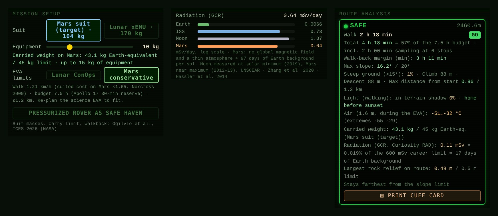

### Why Mars radiation is different

The challenge points out that the radiation environment on Mars differs from those of Earth, Earth orbit and the Moon. The sun & radiation panel shows the four side by side (log scale), and every route card gives the EVA's dose as days of Earth background.

| Where | Dose equivalent per day | Why | Measured by |
|---|---:|---|---|
| Earth surface | 0.0066 mSv | magnetic field and a thick atmosphere | world average, 2.4 mSv/year — UNSCEAR (2000) |
| ISS (inside) | 0.73 mSv | inside Earth's magnetic field, no air; the station hull | as compared in Zhang et al. (2020) |
| Moon surface | 1.37 mSv | no field, no air; the Moon blocks half the sky | Chang'e 4 LND — Zhang et al. (2020), 2019 (solar minimum) |
| **Mars surface** | **0.64 mSv** | no global field, thin CO₂ atmosphere; the planet blocks half the sky | Curiosity RAD — Hassler et al. (2014), 2012–13 |

One sol on the Martian surface ≈ **97 days** of Earth's natural background. A whole 4-hour Marswalk is about 0.1 mSv — the planning concern is the career limit (600 mSv) and solar particle events, which the space-weather advisory covers.

### EVA limits: lunar values or Mars-conservative

NASA's published EVA limits were written for the Moon. NASA's own suited walking test found the metabolic cost at Mars gravity "too high to be acceptable" (Norcross et al. 2009). **Mission setup → EVA limits** switches between the two sets; the planner, the GO / NO-GO checks, the HUD and the cuff card all follow.

| Limit | Lunar ConOps | Mars conservative | Basis for the Mars value |
|---|---|---|---|
| Level walking speed | 2.0 km/h | **1.21 km/h** | 2.0 ÷ 1.65 — suited oxygen cost at Mars vs lunar gravity (27.6 vs 16.7 ml/min/kg, Norcross et al. 2009, Table 5); *assumption*: cost ∝ speed |
| EVA planning budget | 8 h | **7.5 h** | 8 h minus the 30-minute life-support reserve of the Apollo 17 traverse plan |
| Max distance from the habitat | 2 km | **1.2 km** | keeps the lunar 1-hour walk-back at the slower pace |
| Max slope | 20° | 20° | unchanged — no Mars-specific value found |
| Rover walkback (if used) | 30 min | 30 min | NASA Mars suit study (Ogilvie et al. 2026) |

**Same stops, both limit sets** (SAFE route, 09:00 LTST):

| | Jezero, *Mineralogical Diversity* — Lunar | — Mars conservative | Gale, *Geological Contacts* — Lunar | — Mars conservative |
|---|---|---|---|---|
| Stops | <!--fig:jezero.lunar.mineral-diversity.stops-->8<!--/fig--> | <!--fig:jezero.mars.mineral-diversity.stops-->8<!--/fig--> | <!--fig:gale.lunar.contacts.stops-->5<!--/fig--> | <!--fig:gale.mars.contacts.stops-->5<!--/fig--> |
| EVA time | <!--fig:jezero.lunar.mineral-diversity.time-->4 h 46 min<!--/fig--> | <!--fig:jezero.mars.mineral-diversity.time-->6 h 08 min<!--/fig--> | <!--fig:gale.lunar.contacts.time-->2 h 36 min<!--/fig--> | <!--fig:gale.mars.contacts.time-->3 h 12 min<!--/fig--> |
| Share of budget | <!--fig:jezero.lunar.mineral-diversity.share-->60 % of 8 h<!--/fig--> | <!--fig:jezero.mars.mineral-diversity.share-->82 % of 7.5 h<!--/fig--> | <!--fig:gale.lunar.contacts.share-->32 % of 8 h<!--/fig--> | <!--fig:gale.mars.contacts.share-->43 % of 7.5 h<!--/fig--> |
| Tightest walk-back margin | <!--fig:jezero.lunar.mineral-diversity.margin-->3 h 14 min<!--/fig--> | **<!--fig:jezero.mars.mineral-diversity.margin-->1 h 21 min<!--/fig-->** | <!--fig:gale.lunar.contacts.margin-->5 h 24 min<!--/fig--> | <!--fig:gale.mars.contacts.margin-->4 h 18 min<!--/fig--> |
| Farthest from habitat / limit | <!--fig:jezero.lunar.mineral-diversity.farthest-->1.08 / 2 km<!--/fig--> | <!--fig:jezero.mars.mineral-diversity.farthest-->1.08 / 1.2 km<!--/fig--> | <!--fig:gale.lunar.contacts.farthest-->0.72 / 2 km<!--/fig--> | <!--fig:gale.mars.contacts.farthest-->0.72 / 1.2 km<!--/fig--> |
| Hard constraints | all met | all met | all met | all met |

On Jezero's longer loop the Mars-conservative set cuts the safety margin by almost two hours: the same plan is still GO, but with far less room for a late start or a long stop.

### The decision: GO · CONDITIONAL · NO-GO · INSUFFICIENT DATA

Every route card, the mission summary, the cuff card and the JSON export carry the same decision (`web/src/utils/missionStatus.js`), built only from the planner's own figures and the space-weather lookup — with every reason listed.

| Group | Checks | Effect |
|---|---|---|
| **Hard constraints** | walk-back margin ≥ 0 everywhere (no point of no return) · slope ≤ limit · distance ≤ limit · carried weight ≤ 45 kg Earth-equivalent · enough oxygen to walk home from every point · within 30 min of the rover (rover mode) · start after sunrise and home before sunset | one fails → **NO-GO**; one cannot be evaluated (e.g. no start time) → **INSUFFICIENT DATA** |
| **Environment** | space weather: a solar particle event within ±2 days, *or no event data for the date* · tightest margin below the 30-min reserve of the Apollo 17 traverse plan · route crosses a closed depression or an obstacle edge | any open → **CONDITIONAL** |
| **Notes** | radiation dose (at Jezero from a transferred Gale reference) · ground known only from orbit · dust & equipment warnings | shown, do not change the status |
| **Payload** | an itemised payload with a missing or invalid entry | **INSUFFICIENT DATA** (an over-limit payload already fails the carried-weight check) |

**GO** therefore means: every hard constraint met *and* every environmental condition known and clear. Unknown space weather is never read as clear — DONKI records past events and does not forecast, so a future EVA date is CONDITIONAL until it is checked. The daylight rule is a design choice: every Apollo surface EVA was flown in sunlight.

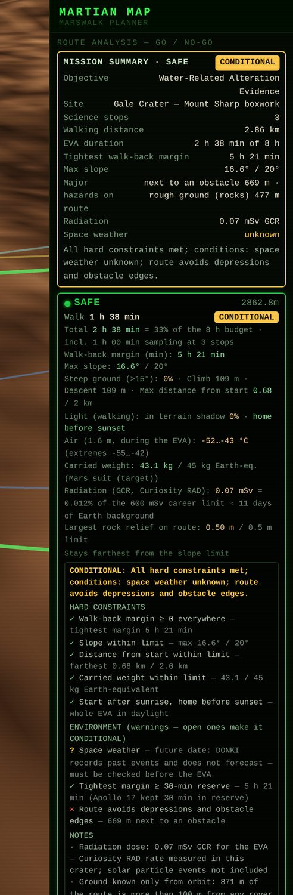

## Hazard map

The **Hazards** layer (`web/src/utils/hazards.js`) classes every 4 m cell from data only — the HiRISE DTM, the 1 m rock-relief layer and the rover's own ground-view positions. No obstacle is placed by hand.

| Class | Rule | Threshold status |
|---|---|---|
| Over the slope limit — *planner wall* | slope > 20° | sourced (NASA ConOps) |
| Rock obstacle — *planner wall* | rock relief in the 1 m DTM > 0.5 m | design choice |
| Next to an obstacle | within 4 m of a wall — rocks under ~2 m are not in the DTM, so a detected obstacle's surroundings are the likeliest to hide more | assumption |
| Closed depression / crater | ≥ 1 m deep after filling the DTM's sinks (priority-flood) | assumption |
| Steep ground | slope > 75 % of the limit (15°) | design choice |
| Rough ground | rock relief > half the obstacle limit (0.25 m) | design choice |
| Beyond rover walk-back | farther than a 30-min walk from the rover (rover mode) | sourced (Ogilvie et al. 2026) |
| Known only from orbit | no rover ground-view position within 100 m | assumption |

**Mission setup → KEEP 4 M FROM OBSTACLES** inflates the planner's walls by that buffer before routing. At Gale the chemical-anomaly SAFE route grows <!--fig:gale.buffer.chem-anomaly-->from 0.84 to 1.33 km and keeps 7 of its 8 stops<!--/fig-->.

The 1 m DTM resolves rocks of a few metres: a cell with no flag is **not** certified rock-free. Smaller rocks are for the crew's eyes and the ground views.

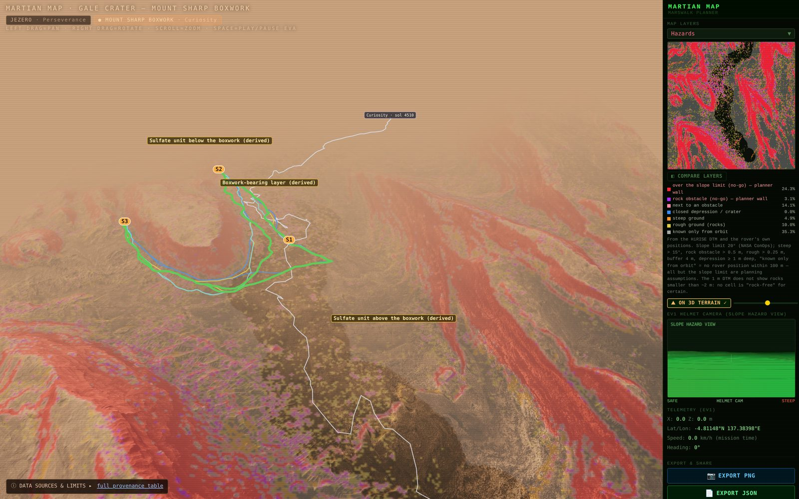

## Suit, payload and dust — three separate assessments

Under the decision of the active route, **EVA assessment** shows three results side by side. Each has its own result and explanation; they are never merged into one risk score. Technical details: [`docs/EVA_ASSESSMENT.md`](docs/EVA_ASSESSMENT.md).

| | Result | Built from | Effect on the decision |
|---|---|---|---|
| **A. Payload & Mass** (`utils/payload.js`) | WITHIN LIMIT · OVER LIMIT · INSUFFICIENT DATA | suit mass + itemised payload (instruments, communications beyond the suit radio, sampling, emergency, other) → weight on Mars as Earth-equivalent kg, limit, remaining capacity | over the limit → the existing carried-weight rule → **NO-GO**; missing / invalid entry → **INSUFFICIENT DATA** |
| **B. Dust Exposure & Equipment Reliability** (`utils/dust.js`, `config/dust.js`) | WARNINGS · INSUFFICIENT DATA | exposure factors of this EVA, seven equipment groups with their own failure mechanism and vulnerability class, the crew's protection settings, precautions, sources | **none** — dust warnings are notes; a dusty EVA is never rejected for dust alone |
| **C. Terrain & Mobility** (`utils/mobility.js`) | PASS · CAUTION · FAIL · INSUFFICIENT DATA | the planner's own A* route, Dijkstra walking times, Tobler slope–speed shape, slope limit, rock obstacles, buffer, depressions, walk-back margin and point of no return | the same hard constraints and conditions as before, unchanged |

**Payload & Mass.** The ~45 kg Earth-equivalent limit is unchanged (NIOSH lifting limit 23 kg + 22 kg offset by suit pressure, Ogilvie et al., ICES 2026). The suit mass already contains the pressure garment and the life-support backpack, so they are listed but cannot be entered again; the suit radio is *assumed* to be part of the backpack mass. Items are entered by the crew — no masses are invented. **Carried mass does not slow the walk**: no validated model of walking speed against carried load at Mars gravity was found, so the payload is a limit, not a speed penalty.

**Dust Exposure & Equipment Reliability.** No source found gives a validated, quantitative model of how Martian dust degrades suits or tools during an EVA. The assessment is therefore qualitative: no failure probabilities, no protection percentages, no degradation rates, and no change to mass or walking speed.

| Component | Failure mechanism | Vulnerability | Why this class |
|---|---|---|---|
| Spacesuit joints (soft goods) | outer fabric abraded where it flexes; dust through the layers | high | Apollo: abrasion not solved by simple mitigation; Ortho-Fabric deficient in lunar-simulant tests |
| Bearings & mechanical interfaces | regolith in bearing races: stiffness, wear, seal damage | high | Apollo: clogging and seal failures; dust-tolerant bearings an open NASA gap |
| External connectors & quick disconnects | dust on mating faces and seals | high | Apollo seal failures; dust-tolerant QDs and connectors open gaps |
| Sampling instruments & tools | coating; clogged hinges and container seals | moderate | meant to touch regolith; risk is in the moving parts and seals |
| Cameras & optical surfaces (incl. visor) | reduced visibility; scratching when wiped | moderate | Apollo visibility loss; scratch-resistant visor an open gap; visor material changes on Perseverance; visible and cleanable in the field |
| Rover interfaces | dust carried into hatches, seals, umbilicals | high | Apollo seal failures; dust brought inside is a crew-health concern |
| Exposed moving mechanisms | jammed valves, latches, actuators | high | Apollo clogging; limited xEMU effort on dust-tolerant mechanisms |

The crew states four **protection settings** in Mission setup: suit outer layer, joint & bearing protection, equipment dust protection and protective covers. "Not specified" is reported as missing information. A protection is shown as *protected — not Mars-validated* and never lowers a vulnerability class. **Exposure factors** are the dusty season (southern spring and summer, Ls 180°–360°), dust-mantled ground on the route (Jezero thermal inertia < 150; no such layer at Gale) and regolith contact at sampling stops. The warnings follow fixed rules, for example *"Exposed mechanical interfaces may be vulnerable to regolith intrusion"*, *"Optical surfaces may require additional protection"*, *"Unprotected joints may require inspection or maintenance"*, and always *"Dust exposure information is insufficient to quantify degradation."*

**Lunar-derived vs Mars-specific evidence.** Every dust source is labelled in the app with its program, date, context, Mars applicability, relevance and limitations:

| Kind | Sources |
|---|---|
| Direct Mars evidence | Perseverance SHERLOC spacesuit-material samples (JPL, 2025; per-material results not yet published) · MRO seasonal dust-storm pattern (JPL / Kass et al., 2016) · THEMIS thermal inertia of Jezero (Edwards & Buz 2021) · Martian dust health review (Wang et al., GeoHealth 2025) |
| Lunar research used as an analogy | Apollo dust effects on EVA systems (Gaier, NASA/TM-2005-213610) · Artemis suit-material tests with lunar simulant (Jones et al., ICES-2025-56) · EVA gap list incl. xEMU status (NASA, 2020) · Dust Mitigation Technology Roadmap (Litofsky, NASA JSC, 2026) |
| Mars analog field research | MARS-V, Gobi Desert — reviewed; no results published, **not used** for any classification |
| Project assumption | how the evidence becomes the classes above |

The **xEMU** is NASA's exploration suit developed for Artemis lunar EVAs; it is not a Mars-certified suit, and the app says so where it is offered. NASA's own roadmap notes that lunar dust mitigation "might not be directly applicable to Martian dust".

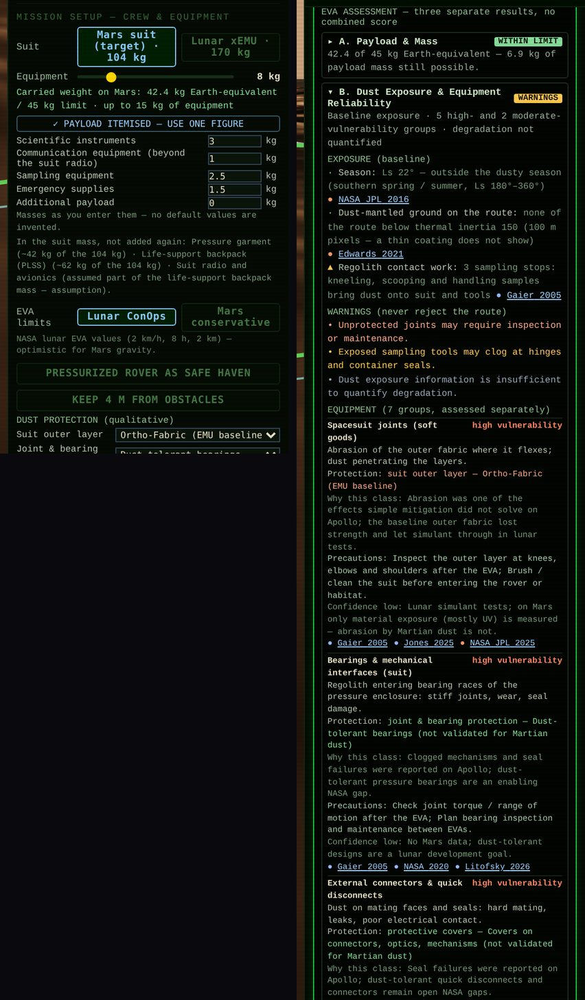

**Terrain & Mobility** reuses what the planner computed and adds nothing: the same speeds apply outbound and on the way back (a test checks that the Mars-conservative factor scales both by 1.65), and payload or dust settings leave the route and every walking time unchanged (a real-data test at Jezero).

## Oxygen and carried mass

Oxygen is tracked on the EVA's mission clock (`web/src/utils/oxygen.js`), so pausing stops it and the speed multiplier only changes how fast mission time runs. Details: [`docs/OXYGEN_AND_MASS.md`](docs/OXYGEN_AND_MASS.md).

| Scenario (Mission setup or live in the HUD) | Architecture | Rate |
|---|---|---:|
| Closed-loop reference | closed-loop PLSS: metabolic O₂ and leakage only | 0.076 kg/h |
| Swing-bed CO₂ removal (default) | CO₂ and water vented to Mars; O₂ lost as sweep gas | 0.15 kg/h |
| Cryogenic O₂ for cooling | O₂ used for thermal control as well as breathing | 1.0 kg/h |

The rates come from NASA's *Life Support Baseline Values and Assumptions Document* (NASA/TP-2015-218570 Rev 2, 2022, §4.6.2) for a 4-hour Mars sortie. They are **architecture references, not the specification of a Mars suit**, and they are constant within a scenario. BVAD gives no per-activity O₂ relation this planner could apply segment by segment, so the rate does not follow activity.

- **O₂ remaining** = max(0, initial − consumed). Initial O₂ is entered by the crew or, if left empty, sized for the suit's 8-h design EVA at the scenario rate. That sizing is an assumption, because no Mars-suit tank capacity is published.
- **Carried mass** = (suit − initial O₂) + O₂ remaining + equipment. The suit mass is taken as the charged suit, so oxygen is never counted twice and the 45 kg carry check is unchanged. The mass falls as O₂ is used but **does not speed up the walk**.
- **Decision.**
  - O₂ that cannot cover the walk home from the route's worst point → **NO-GO**.
  - Return covered but not the reserve → **CONDITIONAL**. The reserve is configurable; its default is the 30-min Apollo 17 reserve.
  - Invalid settings → **INSUFFICIENT DATA**.
- **HUD → O₂ & MASS** shows:
  - a reserve bar
  - initial, remaining and consumed O₂
  - how long the O₂ lasts
  - the O₂ needed to walk home
  - the carried mass
  - two charts: O₂ remaining against *walk home + reserve* and *rest of plan + reserve*, and carried mass over time
  - warnings when the reserve is lost or the return is no longer feasible, including after an abort or a scenario change

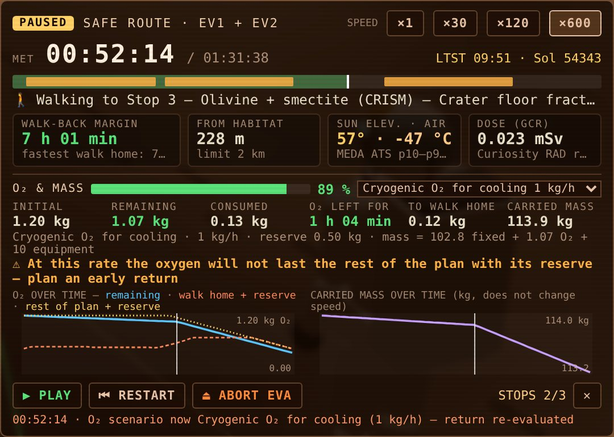

## Data provenance

The data-sources box opens a **provenance table** (`web/src/config/provenance.js`): for every layer of the loaded site, its mission, instrument, original source, observation date or sols, resolution, coverage, data type, processing, status, uncertainty and limitations — and what kind of knowledge it is. Values such as sol ranges and counts are read from the site files, so the table cannot drift from the data.

| Kind | Jezero | Gale |
|---|---|---|
| **Direct measurement** | MEDA air temperature, Perseverance ground views and route, DONKI events | ChemCam chemistry, **RAD radiation**, REMS air temperature, Curiosity ground views and route, DONKI events |
| **Orbital observation** | HiRISE terrain and image, CRISM minerals, THEMIS thermal inertia, Mars 2020 photogeologic map | HiRISE terrain and image |
| **Derived (this project)** | rock relief | rock relief, **geological units** (an interpretation, not a published map) |
| **Transferred reference** | **RAD radiation** (measured in Gale, ~3,750 km away), dose rates of Earth / ISS / Moon | dose rates of Earth / ISS / Moon |
| **Modelled** | sun and local time (Mars24), suited walking speed | same |
| **Simulated** | EVA playback, astronauts, dust devil and its re-route | same |
| **AI-predicted** | terrain classes on 37 Perseverance Navcam frames | terrain classes on 408 Curiosity Navcam frames |
| **Investigated, not available** | SuperCam / PIXL chemistry | CRISM minerals, THEMIS thermal inertia |

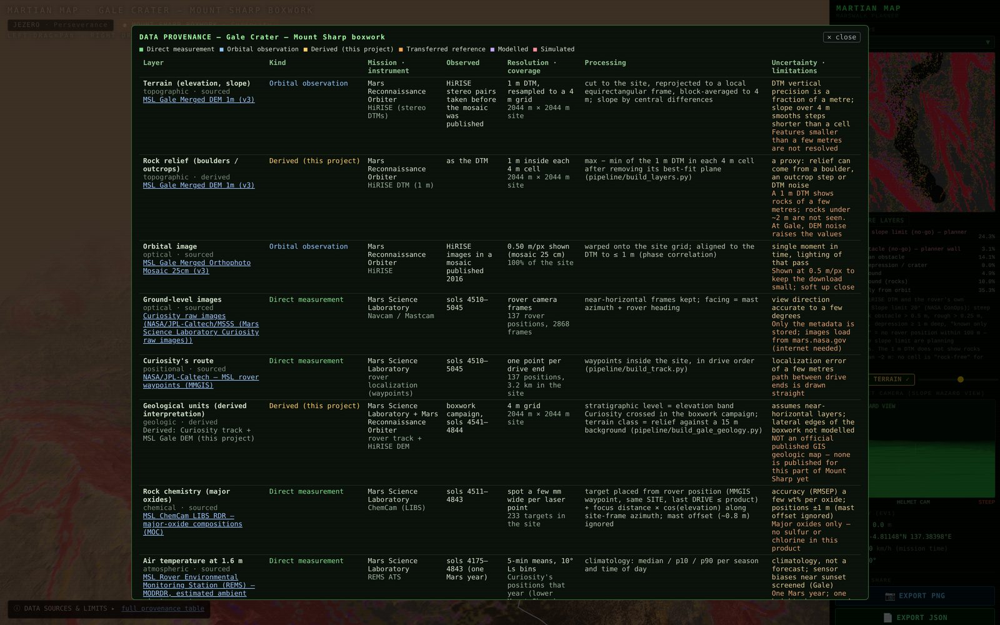

## How a Marswalk is planned

0. **Mission objective.** Filters the candidates below and sets their weights ([table](#mission-objectives--the-plan-follows-the-objective)).
1. **Science stops.** Candidates are the nearest interior point of every geologic unit pair, every bedrock contact and every CRISM mineral within reach — as far as the objective allows. Where rover chemistry exists (Gale), up to two more: the nearest rock for each kind of chemical standout — an oxide more than 2× ChemCam's accuracy away from its layer's mean (e.g. *MgO low*, *CaO high*) — so the crew re-samples what Curiosity flagged; anomalies or targets of one rock share one stop. Pairwise walking times come from Dijkstra; an exact subset DP (Held–Karp) picks the set and order of stops that samples the most distinct units and minerals while walking + time at stops fits the EVA budget (and the rover's 30-minute reach, if used).
2. **Routes.** A* on walking time: Tobler's slope–speed shape scaled to the level pace of the active limit set; cells steeper than 20° or with more than 0.5 m of rock relief are walls. Four route preferences (SAFE, ECO, FAST, AUTO); times always use the same physical model.
3. **Walk-back margin.** At every point: *margin = budget − (time so far + fastest walk home)*. The first point with a negative margin is the **point of no return**.
4. **Decision** — GO / CONDITIONAL / NO-GO / INSUFFICIENT DATA, as above.
5. **Conditions.** For the moment the crew actually walks each point: sun elevation, terrain shadow, darkness, home before sunset or not, expected air temperature, radiation dose and space-weather events.

## At the stops: ground view and rock chemistry

Every stop has a **ground view** — the rover's own camera frames from the nearest position it stopped at, facing the stop — so the crew knows what the place looks like before they get there.

At Gale, stops near rocks Curiosity analysed also have a **chemistry** card: the major oxides ChemCam measured, against the mean of the rock's layer and ChemCam's accuracy. A rock that stands out (here, MgO 4.6 wt% below its layer) becomes a "re-sample" stop.


## Mars AI terrain segmentation — what the ground in the rover images is

A small segmentation network trained on **AI4Mars v0.6** (NASA/JPL crowdsourced and expert labels of Curiosity and
Perseverance images, CC BY 4.0) labels every pixel of the Navcam frames near the route as **soil, bedrock, sand or big
rock**. Open it in **02 ANALYZE → Mars AI Terrain Segmentation**: the original image, the predicted classes, the overlay,
the confidence and the unknown (low-confidence) pixels, with the image's source and the model version.

| | |
|---|---|
| Model | LR-ASPP MobileNetV3-Large, ImageNet-pretrained encoder, cross-entropy + Dice (`mars-terrain-v1.onnx`, 3.2 M parameters) — chosen on validation from three trained variants |
| Training | 14,068 Curiosity + 2,643 Perseverance images, split by Mars day (no near-duplicate frames across splits), 12 epochs, 3.5 h on CPU |
| Curiosity Navcam, expert test (≈ Gale) | mIoU **0.64 / 0.68 / 0.76** (≥1 / ≥2 / ≥3 experts agree) · pixel accuracy 0.90–0.96 |
| Perseverance Navcam, test (≈ Jezero, crowdsourced labels) | mIoU **0.58** · pixel accuracy 0.80 |
| Per class (expert test) | soil 0.89–0.95 · bedrock 0.78–0.91 · sand 0.81–0.91 · **big rock 0.08–0.27** (rare in the labels; mostly missed) |
| Predictions | 408 Curiosity frames at Gale, 37 Perseverance frames at Jezero |

**Honest limits.** These are *model predictions on images*, not NASA measurements, and they are **not georeferenced**
(no camera model or range data): they are never drawn on the map and never change a route, a rule or a number. Big
rocks are poorly detected, so the planner keeps using the 1 m DTM rock relief for obstacles. All three runs stopped on
the time budget while still improving. Every number above is measured — details in
[`docs/MARS_SEGMENTATION.md`](docs/MARS_SEGMENTATION.md).

## NASA tools, resources and design inspiration

The challenge lists five NASA resources; we also looked at NASA's other public map and visualization tools. This is what each one gave the project — data, or only an idea for the interface.

| Resource | What it is | In Martian Map |
|---|---|---|
| [JPL Mars Trek](https://trek.nasa.gov/mars/) | Whole-planet portal: stack and blend layers, measure distances, **elevation plots**, slope and lighting analysis, 3D fly-overs | The same kinds of analysis at Marswalk scale: slope walls, sun and shadow for the EVA's own date and time, 3D view — and an **elevation profile** of every planned route (route card and cuff card), stops numbered |
| [USGS–NASA Planetary Geologic Mapping Program](https://astrogeology-usgs.hub.arcgis.com/pages/interactive-maps-mars) | Standardized geologic maps: the global map at 1:20,000,000 (Tanaka et al. 2014, SIM 3292); for Jezero, Sun & Stack (2020), SIM 3464, at 1:75,000 on a CTX base | Jezero uses the same team's finer, HiRISE-scale photogeologic map (Stack et al. 2020): at 1:75,000 a 2 km site is under 3 cm of map sheet. For Gale no USGS map is published yet — the 1:60,000 map of western Aeolis Mons was finalized in 2023 but still awaited formal USGS review (Thomson et al. 2023) — so Gale's units are derived and labelled as such |
| [Curiosity's proposed path up Mount Sharp](https://science.nasa.gov/resource/curiositys-proposed-path-up-mount-sharp/) (PIA23179) and its 2023 sequel (PIA26042) | Route maps: the rover's path as a pale line over the orbital image, with the regions it crosses labelled | **…'S ROUTE & PLACES**: the rover's own localized route through each site as a pale line on the map and in 3D (Curiosity: 137 positions, 3.2 km; Perseverance: 110 positions, 5.3 km), with entry / exit sols, Octavia E. Butler Landing at Jezero, and Gale's three stratigraphic levels as labelled regions. The planned Marswalk is drawn over it, so the crew sees where a rover has already been |
| [NASA Worldview](https://worldview.earthdata.nasa.gov/) | Earth imagery browser (no Mars data) with a timeline and a **comparison mode** that swipes between two views | Inspiration for the interface only: **COMPARE LAYERS** swipes between any two layers of a site — say the HiRISE image against CRISM minerals or the slope map — and the date / time controls drive sun, temperature and space weather |
| [Mars Perseverance Raw Images](https://mars.nasa.gov/mars2020/multimedia/raw-images/) | Every frame the rover has sent, with sol, camera and local time | All 947 Jezero ground-view frames come from this feed, each linked to its page in the gallery; Gale uses Curiosity's equivalent feed (2,868 frames) |
| [NASA Solar System Treks](https://trek.nasa.gov/) and [Moon Trek](https://trek.nasa.gov/moon/) | The Trek family of portals (Moon, Mars, Mercury, Vesta, Ceres, Titan …): overlay topography, mineralogy and geology; measure; fly over the surface; export terrain for 3D printing | The idea of one place where a crew stacks every layer of a site; the Moon simulator this project grew from (`?site=moon`) has the same lunar setting. No Trek data is used — it is regional, ours is 4 m |
| [NASA Eyes on the Solar System](https://science.nasa.gov/eyes/) | Browser 3D of spacecraft and bodies on a time line (1949–2049), with narrated journeys | The time control: the EVA's date and local solar time drive the sun, shadows, temperature and space-weather lookup. No data used |
| [NASA Eyes on Exoplanets](https://science.nasa.gov/eyes/) | Browser view of more than 1,000 planets of other stars, from the NASA Exoplanet Archive | Not a surface map and not used for data; only the lesson of filters that cut a large catalogue down to what one user needs — here the objective picker |
| Apollo 15–17 cuff checklists | Wrist checklists and traverse planning data | The printable **cuff card** — see below |

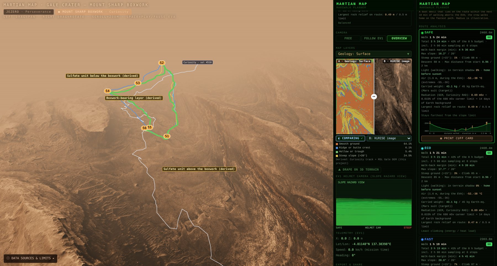

## Martian EVA Cuff — the mission on the astronaut's wrist

**04 OPERATIONS → Martian EVA Cuff → OPEN WRIST CONSOLE** opens a proposed forearm console for the selected mission, inspired by the Apollo 15–17 cuff checklists and rugged wrist displays. A design concept, not a NASA or flight-qualified device — see [`docs/EVA_CUFF.md`](docs/EVA_CUFF.md).

| Key | Screen |
|---|---|
| **F1 STATUS** | mission elapsed time, EVA time left, decision, O₂ left and how long it lasts, walk-back margin, next waypoint |
| **F2 MAP** | the route with stops (done / here / next), hazard marks, the crew's position and any walk-home path |
| **F3 TASKS** | each stop: state, stay, arrival, *leave by*, what to do, geology, objective, kit and terrain risk |
| **F4 HAZARDS** | the route's hazards, each with its kind of evidence (MEASURED, ORBITAL, DERIVED, MODEL, AI-PREDICTED, PROJECT RULE, SIMULATED, NASA REF) |
| **F5 RETURN** | return status and warnings, distance and bearing to the habitat, fastest walk home, margin, EVA time left, O₂ left against the O₂ the walk home needs |
| **EMER** (guarded) | the emergency reference, one press from any screen: only the rules this planner applies and their NASA sources — no invented suit or comms procedures |
| **PLAY · ABORT · PRINT** | drive the EVA playback; open the printed backup |

- **Honest labels.** Position is **PLANNED** before the EVA and **SIMULATED** during the playback, never live telemetry; oxygen is the scenario model, not a tank sensor. The console is **never GO** when the return is unsafe (margin < 0, point of no return passed, O₂ short): it shows **NO-GO / RETURN NOW**.
- **One source of truth.** Console and printed page 2 are built by the same pure function (`web/src/utils/evaCuff.js` `cuffModel()`) from the planner, the decision, the stop cards, the oxygen model and the playback, so they always agree.
- **Offline copy.** The last mission is kept in the browser and shown as *OFFLINE COPY hh:mm — may be stale* when no mission is loaded.
- **Printed backup.** The cuff card gained a second A4 page, the **EVA backup checklist**: tick-box EVA sequence with *leave by* times, equipment, resource limits, return rules, hazards and the emergency reference — usable without the console.

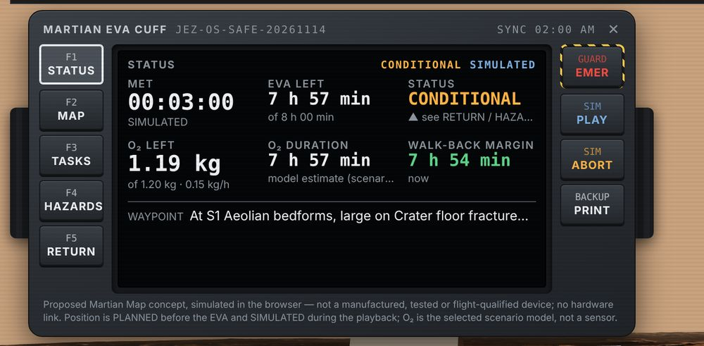

Concept limits: no sensors, positioning, tank pressure, radio link, physical keys or glove testing — position, time and oxygen use come from the playback and the scenario model.

## Inspiration: Apollo cuff checklists

On the Moon, Apollo crews did not carry a screen. They wore a small spiral-bound checklist on the wrist, about 18 × 9 cm, its pages turnable in pressurised gloves, and travelled — on foot or by lunar rover — to stations planned on photo maps. The Apollo 17 traverse planning data gave, for every station, the time to spend there (Station 2: 0+50, Station 3: 0+45 …) and the walk back to the lunar module if the rover failed, with a 30-minute life-support reserve on top.

Martian Map prints the same thing for the planned Marswalk. **PRINT CUFF CARD** on the active route opens one A4 page (Print → Save as PDF):

| Part of the card | What it holds |
|---|---|
| Photo map | grayscale HiRISE image of the route: numbered stations, direction chevrons, north arrow, scale bar, grid measured from the habitat |
| **ARR · STAY** | arrival time and time at the station, in Apollo's *h+mm* mission elapsed time |
| **LEG · LTST · AIR** | distance and bearing from the previous station, local solar time, expected air temperature |
| **BACK** | the fastest walk home from the station |
| **LEAVE BY** | the latest time to leave the station and still be home inside the budget — the column a crew checks on the wrist; if it has passed, skip the next station and walk home |
| **MARGIN** | how much earlier than LEAVE BY the plan leaves |
| Turn-back rules, summary | the rules above, plus distance, climb, minimum margin, dose and temperature range |

Every number on the card is the planner's own: the same timeline the GO / NO-GO decision and the EVA playback use (`web/src/utils/cuffCard.js`, unit tested).

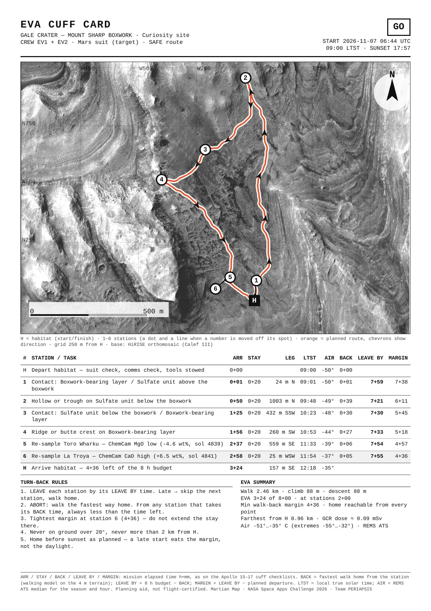

## How it is carried out — EVA playback

- Two astronauts walk the plan on a mission clock (×1 … ×600). Positions come from the planner's own timeline, so what you see is exactly what the GO decision was based on.
- At each stop EV1 kneels and samples while EV2 documents; a flag marks every sampled stop.
- The HUD shows mission elapsed time, the current activity, the **live walk-back margin**, distance from the habitat, the sun, the site's air temperature (MEDA or REMS) and the **radiation dose so far**.
- The **camera angle** sits right under START EVA: *Follow EV1* keeps both astronauts in frame, *Overview* shows the whole route, *Free* lets you fly around. The **helmet camera** under it is EV1's processed view of the ground ahead (elevation contours or slope classes).
- **ABORT EVA** sends the crew home on the fastest path.
- **SIMULATE DUST DEVIL**, right under the site map, arms the drill: click the map to drop a dust devil; what the crew does when they see it is below.

### Dust devil on the route — a new SAFE route, not a run home

Every moment of the playback looks 10 minutes of walking ahead. When the route comes near a dust devil (`web/src/utils/dustReroute.js`):

1. **Safety zone.** A no-go zone of the dust devil's radius **+ 25 m** is set around it, drawn as a dashed yellow ring. Stops inside it are skipped.
2. **New route from where they are.** A new **SAFE** route is planned from the point where the crew saw it, through the remaining stops to the **destination** (the plan's last point), with the zone closed to the planner. A stop being sampled is finished first.
3. **Accepted only if it is safe:** it never comes near the dust devil, the crew can walk home around it at every point within the EVA budget, the oxygen left covers the rest of the plan plus the reserve, and they are home before sunset.
4. **The crew is told.** The new route is drawn in yellow, the EVA timeline, live walk-back margin and oxygen check switch to it, and a message says *"Dust devil detected — 25 m safety zone set; new SAFE route planned from here (+extra time) · skipped stops"*.
5. **Only if no safe route exists** — for example because the terrain closes every way round — the message says *"no new route to the destination found (reason). Returning to the start point the way they came for safety"*, and the crew walks back along the path already walked (around the zone if that path enters it).

A second alarm for the same dust devil aborts the EVA. Details and tests: [`docs/DUST_REROUTE.md`](docs/DUST_REROUTE.md).

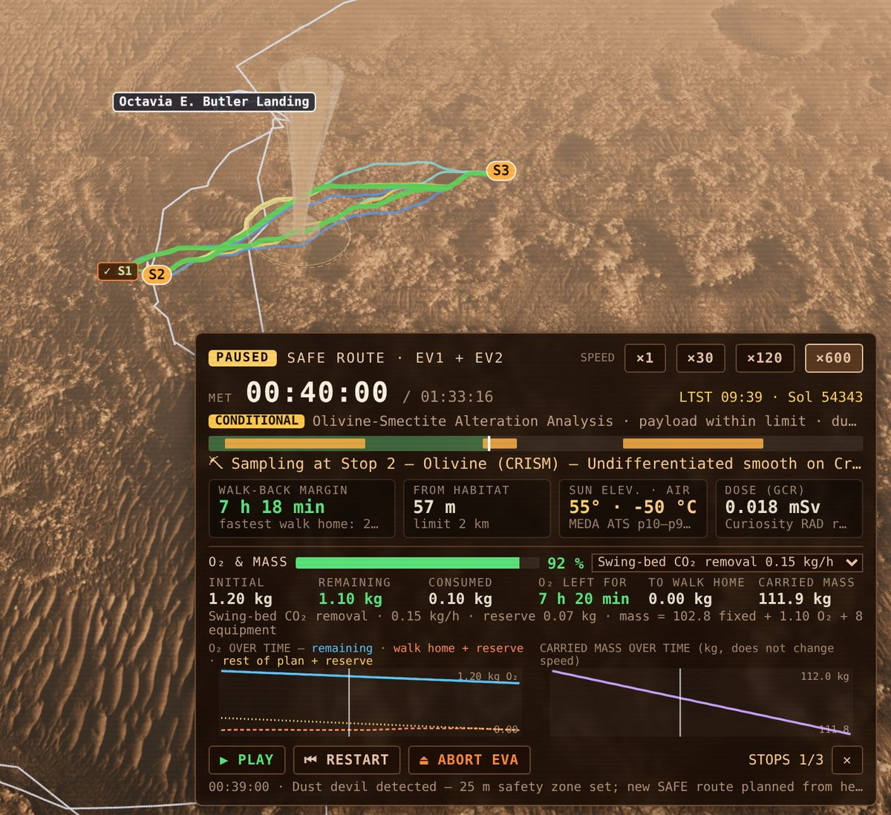

## The layers — real data, labelled by kind

| Layer | Data type | Mission / source | Used for |
|---|---|---|---|
| Terrain, 4 m grid over 2 km | topographic | MRO HiRISE — USGS Mars 2020 TRN DTM mosaic (Jezero); MSL Gale merged DEM 1 m (Gale) | slope walls, walking time, shadows |
| Rock relief | topographic | the same DTMs at 1 m: relief left in each 4 m cell after removing its slope | boulders / outcrops become walls; route card |
| Orbital image, 0.5 m/px | optical | MRO HiRISE orthomosaics (25 cm) — USGS Mars 2020 TRN mosaic (Jezero), MSL Gale merged mosaic (Gale); warped onto the site grid, aligned with the terrain to ≤ 1 m | **HiRISE** terrain mode (default), map base, cuff card |
| 3D relief shading, 1 m | topographic (derived) | surface normals of the same 1 m HiRISE DTM on the site grid (`pipeline/build_relief.py`); they light the 4 m terrain mesh so metre-scale ridges, ripples and scarps show in 3D. **RELIEF ×1** = true slopes; **×2 / ×4** steepen the shading only — heights, slopes, routes and every number stay on the 4 m grid | 3D terrain (DEM and HiRISE modes) |
| Ground-level images | optical | Perseverance and Curiosity raw-image feeds: near-horizontal Navcam / Mastcam(-Z) frames with pointing | ground view at stops |
| Thermal inertia *(Jezero)* | thermal | Mars Odyssey THEMIS — Edwards & Buz (2021) | ground type along the route (dust, sand, rock) |
| Dominant minerals *(Jezero)* | spectral | MRO CRISM — Parente et al. (2021) | science stops (one per mineral), map layer |
| Surface + bedrock units | geologic | Jezero: Mars 2020 science-team photogeologic map — Stack et al. (2020). Gale: derived from Curiosity's track and the DEM | science stops, map layer |
| Rock chemistry *(Gale)* | chemical | Curiosity ChemCam LIBS major oxides (PDS, sols 4511–4843): 233 targets, each placed from the rover position + laser pointing and range | "re-sample" stops; chemistry card |
| Air temperature at 1.45 m *(Jezero)* | atmospheric | Perseverance MEDA, one Mars year — Hueso et al. (2024) | temperature at the time the crew walks |
| Air temperature at 1.6 m *(Gale)* | atmospheric | Curiosity REMS (MODRDR ambient air temperature, PDS), sols 4175–4843 — 20.5 million 1 Hz readings reduced to 5-min means | same, per season (10° of Ls) and time of day |
| Surface radiation | radiation | Curiosity RAD — Hassler et al. (2014): 0.64 mSv/day | EVA dose, HUD |
| Dose rate elsewhere | radiation | UNSCEAR (2000); Zhang et al. (2020) | comparison bars; EVA dose as days of Earth background |
| Space weather | radiation | NASA DONKI (live lookup for the EVA date; optional bundled archive): solar particle events, CMEs modelled to reach Mars, X-class flares | go / postpone advisory for the date |
| Sun, local solar time | — | Mars24 algorithm (NASA GISS) | light, shadow, darkness, mission clock |
| EVA limits | — | NASA xEVA System ConOps; Mars-conservative set from Norcross et al. (2009) and Apollo 17 planning data | walls, speed, budget, radius |
| Suit mass, carry limit, rover walkback | — | NASA Mars suit study — Ogilvie et al. (ICES 2026) | mission setup, GO checks |
| Terrain classes on rover images | AI-predicted | `mars-terrain-v1` trained on AI4Mars v0.6 (Zenodo 10.5281/zenodo.15995036) — image level, not georeferenced | ANALYZE panel, inspector; changes no number |
| Hazard classes | derived | the DTM, rock relief and rover positions above; thresholds in `HAZARD_PARAMS` | Hazards layer, decision, mission summary |

## Verified, not just drawn

`node --test web/tests/*.test.mjs` (175 tests) and `python -m unittest discover pipeline/tests` (11 tests), run on every push before the demo is deployed, together with:

- **Lint** (`pnpm --filter martian-map lint`): undefined names, JSX components that do not exist, rules of hooks.
- **README figures** (`pnpm --filter martian-map readme:figures:check`): every route figure in this README is marked `<!--fig:…-->` and recomputed from the real site files by the planner. The deploy fails if one has drifted; `pnpm --filter martian-map readme:figures` rewrites them.
- **Browser tests** (`.github/workflows/e2e.yml`, `pnpm --filter martian-map e2e` after a build): the production build in headless Chromium.
  - Jezero plan → all four workspaces → decision and three assessments → EVA HUD → cuff card with all its sections + the EVA backup checklist, printed as a two-page A4 PDF (one page each); the wrist console screens and one-press EMER.
  - Phone and tablet: 13-step workflow, no horizontal scroll, HUD clear of the site switcher and the panel.
  - Gale objectives, and the Moon simulator unchanged.
  - Screenshots are uploaded as a build artifact.
- **Segmentation pipeline** (`.github/workflows/mars-segmentation.yml`): 12 Python tests — the AI4Mars label key, splits by Mars day with no frame in two splits, image and label resizing and rejections, the confusion matrix, mean IoU and confidence calibration.

| Area | What is checked |
|---|---|
| Sun | USGS reference values, 60 random epochs against `marstime`, an independent vector check and the MEDA team's sunset table (largest difference 0.25 min over 700 sols); the pipeline's Ls code gives the same values as the app's |
| Terrain & routes | shadow length = height / tan(sun elevation); A* reaches the Dijkstra optimum in every mode; the walk-back maps equal A* times both ways |
| Data | `climate.json` and `geology.json` match independent recomputations from the original files; HiRISE images line up with the DTMs to ≤ 1 m (phase correlation) |
| Planning & playback | the stop optimiser equals brute force on 40 random cases; mineral and chemistry stops are found and scored; the playback timeline equals the planner's round trip; the abort path time equals the Dijkstra return time; morning starts pass the daylight rule, evening and night starts are NO-GO |
| Cuff card | arrival, stay, leg, bearing, BACK, LEAVE BY and margin rebuilt from a hand-made route |
| Elevation profile | distance, absolute elevation, extremes and stops of a hand-made route; thinning keeps stops and extremes |
| Mission objectives | filters decide which candidates exist; different objectives give different stops; every objective's unit, mineral and chemistry names exist in its site's files; one stop per rock |
| Real sites | **Jezero and Gale from the real site files**, through the app's own loader: every objective plans stops within budget that serve it, a SAFE route and a reasoned decision (RAD transferred at Jezero, local at Gale) |
| Moon mode | `?site=moon` stays procedural: no Mars objectives, all four route modes plan around craters |
| Hazards | dilation, sink depth on a pit and a draining slope, class priority and thresholds, rover / orbit classes only when that data exists, hazard length along a route |
| Decision | any failed hard constraint → NO-GO; unevaluable → INSUFFICIENT DATA; unknown space weather → never GO; notes never change the status |
| Payload | total = suit + items; suit parts never added twice; the existing 45 kg limit; remaining capacity; missing or invalid entries → INSUFFICIENT DATA |
| Dust | seven components with different classes, each sourced; lunar / analog / Mars sources kept apart; protection never lowers a class; unknown settings, date and layer reported as missing; no probability, percentage or rate fields |
| Site data consistency | for Jezero and Gale: every layer on the DTM grid (size, cell, row order), the orbital image covering exactly the DTM, centres as documented, 234 rover positions agreeing with their latitude / longitude through the app's projection (< 2 m), track and ChemCam targets inside the site |
| Route & science consistency | for every objective on both sites: each stop reachable and on the route, one stop time per stop counted in the EVA time, the walk-back margin at each stop = budget − elapsed − walk home, tightest margin and point of no return agree, the route's checks agree with its decision |
| Workflow & export | the 13 steps in order; a step is done only when its inputs are complete and current (unknown dust setting, invalid payload or O₂, stops of another objective leave it open); the shared assessment helper and the JSON export carry the current plan, settings, decisions, assessments and provenance (real Jezero) |
| Edge cases (real Jezero) | coordinates outside the site or not finite are rejected (never moved onto the edge); a Gale objective at Jezero is refused; nothing fits → empty stop list; a target in a wall → route ends on the nearest walkable cell; payload over the limit → NO-GO; missing dust settings → dust INSUFFICIENT DATA, decision unchanged; future date → space weather unknown, never GO; 7.5-h stay → negative margin, point of no return, NO-GO, oxygen NO-GO; excessive slope stays NO-GO whatever payload / dust / oxygen say; no start time → INSUFFICIENT DATA |
| Oxygen & mass | BVAD values; depletion per scenario; zero boundary; pause and speed multipliers; walking, stops and abort consume; rate change mid-EVA not retroactive; reserve and depletion warnings; mass without double counting; NO-GO / CONDITIONAL / INSUFFICIENT DATA; real Jezero and Gale routes; Moon mode unaffected |
| Dust devil re-route | around a dust devil on the leg ahead (both stops kept, never inside the trigger radius, home, margin ≥ 0, restart); a dust devil on a stop skips it; budget too tight → abort and the walk home avoids it; strict "no path" when it closes home; a second alarm aborts; a one-way plan re-routes to the destination, and the fallback retraces the way they came |
| Wrist console | PLANNED before and SIMULATED during the EVA; route mode, payload and decision changes reach it; stop states and live margin follow the playback; never GO with an unsafe return; equipment and sources; no invented suit procedures |
| Workspaces | the catalog lists only what the site loaded, each item with a provenance record; route-mode explanations are the planner's own weights; timeline legs, stops and walk home tile the planned round trip; the point inspector reads the grids and follows the planner's thresholds; it offers *add as waypoint* only on cells the router can walk (real Jezero) |
| 3D relief shading | the relief texture covers the site grid exactly; decoding (flat = straight up, 45° east face = 45°); emphasis changes only the shading, heights stay unchanged; Python tests for the normals from the 1 m DTM |
| AI segmentation | AI4Mars class mapping and unknown pixels; mask colours and statistics; nearest prediction to a rover position; index and model card validation; both sites' prediction files present and linked to real rover positions |
| Mobility & integration | no payload or dust penalty (real Jezero route and walking times identical with 0 and 40 kg); the Mars speed factor applies outbound and on the return; dust never changes the decision; an over-limit payload is NO-GO through the existing rule |
| Provenance | every record complete and categorised against the real files; Jezero RAD transferred; Gale geology derived; CRISM / THEMIS / SuperCam shown as unavailable with reasons |
| Rover track | waypoints come out in drive order and split where the rover leaves the site; every region label lies inside its own unit |
| Share link | site, start, date, mission setup and route survive the link; bad links are ignored |
| Safety numbers | GCR dose scaling, the SEP advisory window, the suit carry limit (Mars suit passes, xEMU fails), the rover drive estimate, the dose comparison, and both EVA limit sets (values, sources, walking-time scaling) |

## Honest limits

- **EVA limits.** The lunar ConOps values are optimistic for Mars; the Mars-conservative set is derived, not official. Its speed assumes metabolic cost grows in proportion to speed, and the test suit (120 kg MKIII) is heavier than the 104 kg Mars-suit target, so the 1.65 factor may overstate the cost for a lighter suit. The slope limit is lunar in both sets.
- **Dose comparison.** All four rates are measured, but in different parts of the solar cycle: the Moon value is from 2019 (solar minimum, cosmic rays at their strongest), the Mars value from 2012–13 (near solar maximum). Part of the Moon–Mars gap is that timing. The Earth value is the total natural background, not only cosmic rays.
- **Radiation at Jezero.** RAD measured at Gale, about 1.8 km lower than Jezero; with less atmosphere above it, the real dose at Jezero is likely a little higher.
- **Design choices.** How slope changes suited walking speed is an assumption (Tobler shape). Time per stop, the objectives' weights, the 0.5 m rock-relief limit, the hazard thresholds other than the slope limit, the ±2-day SEP window and the 10 km/h rover speed are design choices or assumptions, labelled as such in the app.
- **Objectives.** They select among the layers each site has; they do not add data. The Jezero delta is outside the 2 km site, so the lake-and-delta objective can only sample crater-floor rocks. "CaO high" stands in for calcium-sulfate veins because this ChemCam product reports no sulfur. Gale's ridge / hollow classes come from a DEM that does not resolve single boxwork ridges.
- **Dust and equipment.** Qualitative only: no validated data gives degradation rates or failure probabilities for suits or tools in Martian dust, so none are computed. Most evidence is lunar (Apollo, lunar simulant) and is used as an analogy; the Perseverance spacesuit samples are Mars data but their per-material results are not yet published. Dust-mantled ground is known only at Jezero (100 m thermal-inertia pixels); the dusty season is a seasonal pattern, not a storm forecast.
- **Oxygen.** The rates are NASA architecture references for a 4-hour Mars sortie, not measured Mars-suit consumption, and they do not follow activity. A Mars-suit oxygen capacity is not published, so the sized initial oxygen is an assumption, as is the suit mass including its oxygen. Secondary oxygen and buddy sharing are not modelled.
- **Payload.** Carried mass does not change walking speed, because no validated load–speed model at Mars gravity was found; the payload acts only through the weight limit. The suit radio is assumed to be inside the life-support mass.
- **Dust devil.** It stands still (real ones drift with the wind); its 35 m radius, the ×1.35 trigger and the 25 m safety distance are illustrative design choices, and no NASA EVA dust-devil avoidance procedure was found — the re-route is a planning demonstration, not an operational rule.
- **Wrist console.** A proposed concept running in the browser: no hardware, sensors, positioning, tank pressure or radio link; position, time and oxygen come from the playback and the scenario model, and the "offline copy" is browser storage.
- **Interface.** The Moon simulator (`?site=moon`) keeps its original single-panel layout; 3D stop badges and route segments are not clickable (stops open from the stop list or the timeline).
- **Hazards.** Closed depressions are found only where the DTM sees them (≥ 1 m deep); "known only from orbit" uses the positions the rover took ground views from, not everywhere it could see.
- **Resolution.** A 1 m DTM shows rocks of a few metres, not smaller ones. Jezero's landing area was chosen for being smooth, so there only a handful of cells exceed the 0.5 m rock-relief limit. CRISM mineral names are the closest match of each spectral class. Thermal-inertia classes are guidance.
- **Time.** Temperatures are a one-Mars-year climatology, not a forecast. Space weather is queried live from api.nasa.gov for the EVA date (public demo key, rate-limited); offline, or when the lookup fails, the advisory says there is no data. `fetch-donki.yml` can bundle a DONKI archive since 2012 so past dates also work offline — it needs a free NASA API key as the repository secret `NASA_API_KEY`, because GitHub's shared runners hit the demo-key limit. DONKI has no forecast: for a future EVA the advisory says there is no data.
- **Gale geology.** There is no published GIS geologic map of this part of Mount Sharp. The units are derived and say so: *stratigraphic level* is the elevation band Curiosity crossed during the boxwork campaign (−3655 to −3595 m; the rover was always below it before sol 4541 and always above it after leaving the boxwork), on the assumption that the layers are close to horizontal — the lateral edges of the boxwork terrain are not modelled. *Terrain class* (ridge, hollow, smooth, steep) is relief against a 15 m background in the 2016 merged DEM, which does not resolve the individual boxwork ridges (a few metres wide). About a quarter of the cells are steeper than 20°, and DEM noise raises the rock-relief layer, so routes are more constrained than at Jezero. No THEMIS or CRISM layer: THEMIS offers Gale only as a qualitative thermal-inertia image without units, and no processed CRISM mineral map of this site was found.
- **Gale air temperature.** One Mars year (sols 4175–4843) of REMS's own estimate of ambient air temperature, kept only where REMS flags the reading reliable. On a few sols the sensor drops to −115…−120 °C around sunset, which no flag catches; a robust screen against the other sols of the same season and time removes them (76 of 75,703 five-minute means). Curiosity drove a few kilometres that year, so this is the climate of lower Mount Sharp rather than of one spot. Gale nights are on average 8 °C warmer than Jezero's (from 3 °C colder to 18 °C warmer by season): Gale is 1.8 km lower and closer to the equator.
- **Chemistry.** ChemCam analyses a spot a few millimetres wide, at 2–3 m from the mast; its accuracy (RMSEP) is a few wt% for the major oxides, shown on every bar. Target positions ignore the mast offset (about a metre). Jezero has no chemistry layer: SuperCam major-oxide results exist only as supplementary CSV in the PDS Analyst's Notebook ("not archived products") without target coordinates, and PIXL maps millimetre-scale patches.
- **Images.** The orbital image is shown at 0.5 m/px (the mosaics are 25 cm) to keep the download near 4 MB per site; up close it is soft, so the DEM mode is better for close-ups. It is a single moment in time, with the lighting of that HiRISE pass. Ground-view directions are mast azimuth + rover heading, accurate to a few degrees; only the metadata is stored and the images load from mars.nasa.gov, so ground views need an internet connection (the viewer says so when a frame cannot load).

## Data & credits

**Terrain and images**
- USGS Astrogeology (2020). *Mars 2020 Terrain Relative Navigation HiRISE DTM Mosaic.* [doi:10.5066/P9REJ9JN](https://doi.org/10.5066/P9REJ9JN)
- USGS Astrogeology (2020). *Mars 2020 Terrain Relative Navigation HiRISE Orthorectified Image Mosaic.* [doi:10.5066/P9QJDP48](https://doi.org/10.5066/P9QJDP48)
- Parker, T. & Calef III, F. J. (2016). *MSL Gale Merged DEM 1m*, v3. PDS Annex, USGS. [astrogeology.usgs.gov](https://astrogeology.usgs.gov/search/map/mars_msl_gale_merged_dem_1m)
- Calef III, F. J. & Parker, T. (2016). *MSL Gale Merged Orthophoto Mosaic 25cm*, v3. PDS Annex, USGS. [astrogeology.usgs.gov](https://astrogeology.usgs.gov/search/map/mars_msl_gale_merged_orthophoto_mosaic_25cm)
- NASA/JPL-Caltech. Mars 2020 Perseverance raw images (Navcam, Mastcam-Z) and rover waypoints (MMGIS).
- NASA/JPL-Caltech/MSSS. Mars Science Laboratory Curiosity raw images (Navcam, Mastcam) and rover waypoints (MMGIS); boxwork campaign dates from the NASA Curiosity mission blog.

**Geology, minerals, chemistry**
- Stack, K. M., et al. (2020). *Photogeologic map of the Perseverance rover field site in Jezero crater.* Space Sci. Rev. 216, 127. [doi:10.1007/s11214-020-00739-x](https://doi.org/10.1007/s11214-020-00739-x) (CC BY 4.0)
- Parente, M., Saranathan, A. M., Itoh, Y., Tarnas, J. D., Seelos, F. P., Mustard, J. F. (2021). *Map of the dominant mineralogy over and around the Mars2020 landing ellipse.* Zenodo. [doi:10.5281/zenodo.5575824](https://doi.org/10.5281/zenodo.5575824) (CC BY 4.0)
- Edwards, C. S. & Buz, J. (2021). *THEMIS-derived Thermal Inertia of Jezero Crater, Mars.* Zenodo. [doi:10.5281/zenodo.4931348](https://doi.org/10.5281/zenodo.4931348) (CC BY 4.0)
- Sun, V. Z. & Stack, K. M. (2020). *Geologic map of Jezero crater and the Nili Planum region, Mars.* USGS Scientific Investigations Map 3464, 1:75,000. [doi:10.3133/sim3464](https://doi.org/10.3133/sim3464) — regional context; not used as a layer.
- Tanaka, K. L., et al. (2014). *Geologic map of Mars.* USGS Scientific Investigations Map 3292, 1:20,000,000. [doi:10.3133/sim3292](https://doi.org/10.3133/sim3292) — global context; not used as a layer.
- Thomson, B., Ettenborough, I., Buczkowski, D., Seelos, K. D., Weitz, C. (2023). *Updated geologic map of the western portion of Aeolis Mons, Gale crater.* GSA Connects 2023, Paper 113-12. [abstract](https://gsa.confex.com/gsa/2023AM/webprogram/Paper394643.html) — the 1:60,000 map not yet published.
- Wiens, R. C., Maurice, S., et al. *MSL ChemCam LIBS derived data (RDR), major-oxide compositions*, PDS Geosciences Node (Release 42, 2026); calibration: Clegg, S. M., et al. (2017), Spectrochim. Acta B 129, 64–85.

**Rover images for AI segmentation**
- Swan, R. M., Atha, D., Leopold, H. A., Gildner, M., Oij, S., Chiu, C., Ono, M. (2021). *AI4Mars: A dataset for terrain-aware autonomous driving on Mars.* CVPR Workshops. Data: Swan, R. M., Ono, M., Atha, D. (2022), *AI4Mars merged v0.6*, NASA/JPL, Zenodo, [doi:10.5281/zenodo.15995036](https://doi.org/10.5281/zenodo.15995036) (CC BY 4.0)
- Howard, A., et al. (2019). *Searching for MobileNetV3* (LR-ASPP segmentation head). ICCV 2019. [arXiv:1905.02244](https://arxiv.org/abs/1905.02244)

**Atmosphere and radiation**
- Hueso, R., et al. (2024). *Derived environmental temperatures at Jezero crater from the Perseverance Air Temperature Sensors* (v2). Zenodo. [doi:10.5281/zenodo.11198655](https://doi.org/10.5281/zenodo.11198655) (CC BY 4.0)
- Gómez-Elvira, J., et al. (2012). REMS: The Environmental Sensor Suite for the Mars Science Laboratory Rover. *Space Sci. Rev.* 170, 583–640. Data: REMS MODRDR, NASA PDS Atmospheres Node (mslrem_1001).
- Hassler, D. M., et al. (2014). *Mars' surface radiation environment measured with the Mars Science Laboratory's Curiosity rover.* Science 343, 1244797. [doi:10.1126/science.1244797](https://doi.org/10.1126/science.1244797)
- Zhang, S., Wimmer-Schweingruber, R. F., et al. (2020). First measurements of the radiation dose on the lunar surface. *Science Advances* 6, eaaz1334. [doi:10.1126/sciadv.aaz1334](https://doi.org/10.1126/sciadv.aaz1334)
- UNSCEAR (2000). *Sources and Effects of Ionizing Radiation* — 2.4 mSv/year natural background. [UN press release](https://press.un.org/en/2000/20000606.ga9718.doc.html)
- NASA Community Coordinated Modeling Center. *DONKI — Space Weather Database Of Notifications, Knowledge, Information.* [kauai.ccmc.gsfc.nasa.gov/DONKI](https://kauai.ccmc.gsfc.nasa.gov/DONKI/)
- NASA-STD-3001 Volume 1, Rev B (2022): career effective dose limit 600 mSv.

**EVA operations**
- NASA EVA-EXP-0042 Rev B (2020), *Exploration EVA System ConOps*. NASA (2020), *EVA Lunar Surface ConOps*.
- Norcross, J., et al. (2009). *Feasibility of Performing a Suited 10-km Ambulation on the Moon.* NASA/TP-2009-214796. [lpi.usra.edu](https://www.lpi.usra.edu/lunar/artemis/NorcrossEtAl_NASA-TP-2009-214796_EVA%20Walkback%20Test.pdf)
- Ogilvie, R., et al. (2026). *Mars Spacesuit Mass Requirements.* ICES-2026. [NASA NTRS 20260005410](https://ntrs.nasa.gov/citations/20260005410)
- NASA Manned Spacecraft Center (1972). *Apollo 17 Traverse Planning Data*, 3rd ed.; Apollo Lunar Surface Journal. [nasa.gov](https://www.nasa.gov/wp-content/uploads/static/history/alsj/a17/A17TraversePlanningData.pdf) · Cuff checklist, EVA 2 & 3, Apollo 16, Smithsonian National Air and Space Museum. [Google Arts & Culture](https://artsandculture.google.com/asset/cuff-checklist-eva-2-3-apollo-16-young/0wHa5HswXSXP3Q)
- NASA/JPL-Caltech/ESA/Univ. of Arizona/JHUAPL/MSSS/USGS Astrogeology Science Center. *Curiosity's Proposed Path up Mount Sharp* (PIA23179, 2019) and *Curiosity's Path to Gediz Vallis Ridge and Beyond* ([PIA26042](https://science.nasa.gov/photojournal/curiositys-path-to-gediz-vallis-ridge-and-beyond/), 2023) — the route-map style. NASA/JPL *Mars Trek* ([about](https://trek.nasa.gov/mars/jpl/config/textAbout.html)) — elevation plots. NASA *Worldview* ([comparison mode](https://www.earthdata.nasa.gov/news/blog/introducing-worldviews-comparison-feature)) — layer swipe.
- Allison, M. & McEwen, M. (2000). Mars24 algorithm, NASA GISS. Tobler, W. (1993), NCGIA TR 93-1.

Audit, feature status and remaining limits for the challenge brief: [docs/CHALLENGE_COMPLIANCE.md](docs/CHALLENGE_COMPLIANCE.md). Payload, dust and mobility assessments: [docs/EVA_ASSESSMENT.md](docs/EVA_ASSESSMENT.md). Oxygen and carried mass: [docs/OXYGEN_AND_MASS.md](docs/OXYGEN_AND_MASS.md). Four workspaces: [docs/WORKSPACES.md](docs/WORKSPACES.md). Dust devil re-route: [docs/DUST_REROUTE.md](docs/DUST_REROUTE.md). Wrist console and backup checklist: [docs/EVA_CUFF.md](docs/EVA_CUFF.md). AI terrain segmentation: [docs/MARS_SEGMENTATION.md](docs/MARS_SEGMENTATION.md). Final integration and acceptance report: [docs/FINAL_VALIDATION.md](docs/FINAL_VALIDATION.md).

## Use of AI

Developed with AI assistance (Anthropic Claude) for code, data pipelines, tests and documentation, under the team's direction and review. All data come from the sources above. The astronauts, dust devil and other 3D objects are original procedural models written in code; no AI-generated images are used. The terrain segmentation model is a separate, small network the team trained on the NASA/JPL AI4Mars labels; its outputs are labelled AI-PREDICTED everywhere they appear and never change a route, a rule or a number.

## Repository map

```
web/     the web app (React + Three.js / react-three-fiber, Vite)
  src/utils/              walkModel · pathfinder (A*) · walkback (Dijkstra) · science (stop optimiser)
                          radiation · marsTime (Mars24) · shadows · climate · chemistry · cuffCard · elevationProfile
                          evaTimeline + evaPlayback · orthoImage · hazards · missionStatus · stopCards · shareLink
                          payload · dust · mobility (the three EVA assessments) · oxygen
                          evaAssessments (one route → decision + assessments + export) · workflow (13 steps)
                          dustReroute (safety zone, SAFE re-plan to the destination, retrace fallback) · evaCuff (wrist console + backup model)
                          relief (1 m shading) · segmentation (AI terrain classes) · inspect (point inspector) · missionTimeline · routeModes
  src/hooks/              useSpaceWeather (DONKI lookup for the EVA date)
  src/config/             marswalkProfile (EVA limits, hazard thresholds) · mission (suit, equipment, rover)
                          objectives (5 per site) · provenance (every layer, every kind) · dust (sources, components) · oxygen (BVAD scenarios)
                          catalog (data catalog from the loaded site) · crew (astronaut scale, EV2 offset)
  src/workspace/          TopBar (site, workspaces, mission status) · LayerCatalog · Inspector · MissionTimeline · WelcomeGuide · EvaCuff (wrist console)
  src/components/         MoonScene (3D, follow camera) · MarsCrew · EvaHud · RightPanel (panel per workspace) · SiteSwitcher · MiniMap · HeatmapViewer
                          HelmetCamPreview · MissionDecision (workflow strip, summary, decision) · ui (small shared parts, closed slots)
                          PovViewer (ground view) · ChemistryCard · CuffCard (+ backup checklist) · ElevationProfile · ProvenancePanel · EvaAssessment
                          OxygenPanel · TerrainSegmentation
  public/sites/jezero/    grid.bin · ortho (HiRISE) · relief (1 m DTM normals) · geology · climate (MEDA) · layers (THEMIS, CRISM, rocks) · pov · track · segmentation
  public/sites/gale/      grid.bin · ortho (HiRISE) · relief (1 m DTM normals) · geology (derived) · climate (REMS) · layers (rocks) · chemistry (ChemCam) · pov · track · segmentation
  tests/                  node --test suites (incl. real Jezero / Gale runs and Moon mode)
  e2e/                    browser tests on the production build (Playwright)
  scripts/                readmeFigures (README route figures from the planner)
pipeline/                 fetch_sources · fetch_gale · fetch_chemistry · fetch_rems
                          build_site · build_ortho · build_relief · build_layers · build_space_weather · build_pov · build_track
                          build_climate · build_climate_rems · build_geology · build_gale_geology · build_chemistry
                          build_offline
  segmentation/           AI4Mars inventory · prepare · train · evaluate · infer_sites (Mars AI terrain segmentation)
MartianMap/               ready-to-run offline package
```

`?site=moon` still opens the original procedural Moon rover simulator this project grew from (TUA Astro Hackathon).

## Rebuilding the data

The processed data are committed, so the app runs as is. Sources are fetched by GitHub Actions into `pipeline/sources/`:

| Workflow | Fetches |
|---|---|
| `fetch-sources.yml`, `fetch-dtm.yml` | Jezero: DTM, THEMIS, CRISM, geology, MEDA, Perseverance waypoints and images |
| `fetch-gale.yml`, `fetch-gale-pov.yml` | Gale: Curiosity waypoints, site centre, 1 m DEM window, site grid, Curiosity ground views |
| `fetch-ortho.yml` | HiRISE orthomosaics for both sites (also builds the textures) |
| `fetch-chemistry.yml` | ChemCam major-oxide tables and target geometry |
| `fetch-rems.yml` | one Mars year of REMS air temperature, reduced to 5-min means |
| `fetch-donki.yml` | DONKI solar particle events, Mars-bound CMEs and X flares since 2012 → `space_weather.json` (both sites; weekly). Needs the secret `NASA_API_KEY` |
| `mars-segmentation.yml` | AI4Mars v0.6 from Zenodo and the rover Navcam frames; trains, evaluates and exports the segmentation model and the site predictions. Started by pushing `pipeline/segmentation/RUN` on an `ml/**` branch with a stage: `inventory`, `smoke`, `full`, or `finish <run-id>` |

Then:

```bash
pip install -r pipeline/requirements.txt
python pipeline/build_layers.py         # THEMIS, CRISM, rock relief → layers.json
python pipeline/build_layers.py --site gale && python pipeline/build_gale_geology.py
python pipeline/build_chemistry.py      # ChemCam targets → sites/gale/chemistry.json
python pipeline/build_relief.py         # 1 m DTM normals → sites/<site>/relief.jpg (3D relief shading)
python pipeline/build_track.py --site jezero --rover m20   # the rover's own route + places → track.json
python pipeline/build_track.py --site gale --rover msl
python pipeline/build_climate_rems.py   # REMS 5-min means → sites/gale/climate.json
python pipeline/build_space_weather.py  # DONKI → space_weather.json
python pipeline/build_offline.py        # refresh MartianMap/app
```

## License

MIT for the code. Data keep their own licenses (CC BY 4.0 or public domain, listed above).
