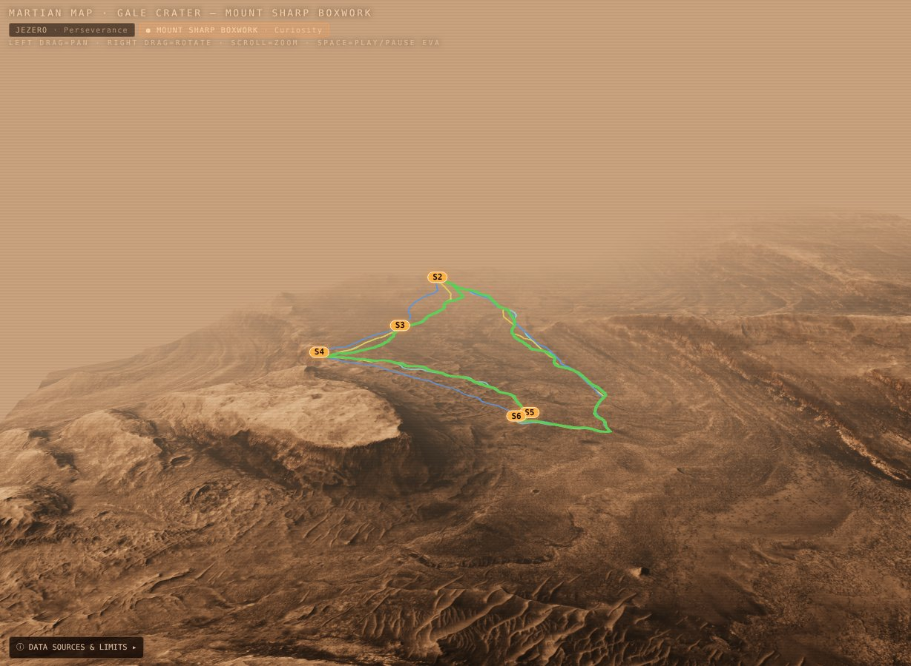
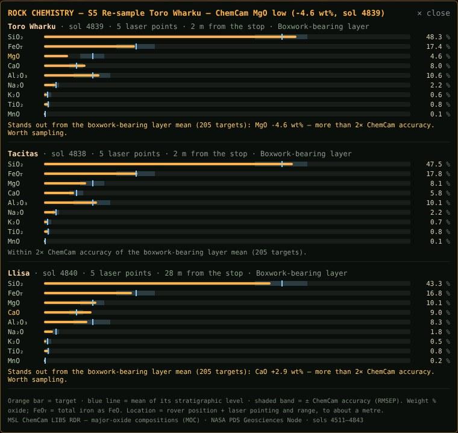

<p align="center">
  <a href="https://sayko89.github.io/nasa-space-apps-challenge-2026/"></a>
</p>

<p align="center">
  <a href="https://sayko89.github.io/nasa-space-apps-challenge-2026/"></a>
  
  
  <a href="https://github.com/sayko89/nasa-space-apps-challenge-2026/actions/workflows/deploy-pages.yml"></a>
</p>

<p align="center"><b>Team PERIAPSIS</b> · NASA Space Apps Challenge 2026 · <i>Interplanetary Survival Guide: Martian Map</i></p>

---

The first people to walk on Mars will want the best map possible. **Martian Map** is that map for two real places where NASA rovers have worked: the floor of **Jezero crater** around the Perseverance landing site, and the **boxwork ridges of Mount Sharp** in Gale crater that Curiosity explored in 2025–26. It layers data from **four NASA Mars missions** into a single 3D view, plans a two-person **Marswalk** that visits the most interesting rocks, minerals and chemistry, proves at every step that the crew can still walk home (or back to their rover), plays the whole EVA out on a mission clock — and prints it as an Apollo-style **cuff card** for the wrist.

> **Why another Mars map?** Tools like JPL's Mars Trek and the USGS–NASA geologic maps layer data over the whole planet, at regional scale. An astronaut on a single Marswalk needs the opposite: one 2 km × 2 km area, every layer on the same **4 m grid**, rocks picked out at **1 m**, and a plan that says *where to walk, what to sample, and when to turn back*. Martian Map is built for that hyperlocal scale.


## At a glance

| | |
|---|---|
| **Sites** | 2 — Jezero crater (Perseverance) and Mount Sharp boxwork, Gale crater (Curiosity) |
| **NASA missions** | 4 — Mars Reconnaissance Orbiter, Mars Odyssey, Mars 2020, Mars Science Laboratory |
| **Data types** | 8 — topographic, optical, thermal, spectral, geologic, chemical, atmospheric, radiation |
| **Resolution** | 4 m grid over 2 km × 2 km; rocks from 1 m DTMs; orbital image at 0.5 m/px |
| **Ground views** | 3,815 rover camera frames from 234 rover positions |
| **Safety checks** | walk-back margin and point of no return, slope, radius, carry weight, rover reach, sunset, dose, space weather |
| **EVA limit sets** | Lunar ConOps (NASA) or **Mars conservative** (derived for Mars gravity) |
| **Outputs** | 3D planning view, live EVA HUD, printable **cuff card** (A4 / PDF) |
| **Tests** | 61 JavaScript + 5 Python, run on every push before deploy |

## Try it

| | |
|---|---|
| **Online** | **[sayko89.github.io/nasa-space-apps-challenge-2026](https://sayko89.github.io/nasa-space-apps-challenge-2026/)** — nothing to install |
| **Offline** | **Code → Download ZIP** → unzip → `MartianMap/Start-Windows.bat` (Windows) or `MartianMap/start-mac-linux.sh` (macOS / Linux). Needs only Python 3. |
| **From source** | `pnpm install`, then `pnpm dev` (tests: `pnpm test`) |

**Quick tour**

1. Pick a site at the top left (**JEZERO** or **MOUNT SHARP BOXWORK**).
2. **Mission setup:** suit, equipment, **EVA limits** (Lunar ConOps / Mars conservative), and whether a pressurized rover waits at the start.
3. **PLAN SCIENCE EVA** — the planner picks and orders the stops; open **ground view** or **chemistry** on any stop.
4. Pick a route (SAFE / ECO / FAST / AUTO) and read its **GO / NO-GO** card.
5. **PRINT CUFF CARD** for the one-page wrist card.
6. **START EVA** (×1 … ×600, **ABORT EVA**, **SIMULATE DUST DEVIL**).
7. **Terrain mode** DEM / HiRISE / WIRE, and **Map Layers → DRAPE ON 3D TERRAIN** for minerals, thermal inertia, rocks, geology or slope.

## Two sites, one pipeline

<table>
<tr>
<td width="50%"></td>
<td width="50%"></td>
</tr>
<tr><td align="center"><b>Jezero crater</b> — 8-stop EVA on the crater floor</td><td align="center"><b>Mount Sharp boxwork, Gale</b> — 6-stop EVA on the boxwork layer</td></tr>
</table>

| | Jezero crater | Mount Sharp boxwork, Gale crater |
|---|---|---|
| Rover that explored it | Perseverance (Mars 2020) | Curiosity (MSL) |
| Centre | 18.440° N, 77.450° E | 4.811° S, 137.384° E |
| Elevation in the site | −2609 … −2545 m (flat crater floor) | −3820 … −3350 m (steep, layered) |
| How the site was chosen | around the landing site | from Curiosity's own track during the boxwork campaign (sols 4541–4844) |
| Science objective | sample as many bedrock and surface units, contacts and CRISM minerals as an EVA allows | sample boxwork ridges and hollows, the contacts of the boxwork-bearing layer, and rocks whose ChemCam chemistry stands out |
| Ground views | 947 Navcam / Mastcam-Z frames, 97 positions | 2,868 Navcam / Mastcam frames, 137 positions |
| Planned science EVA (SAFE, lunar limits) | 8 stops · 4.11 km · 4 h 45 min · tightest margin 3 h 15 min · **GO** | 6 stops · 2.46 km · 3 h 24 min · tightest margin 4 h 36 min · **GO** |

The second site came out of the same pipeline as the first: pick a centre, cut the 1 m DTM and the orbital image, build the 4 m grid, rock relief, units, chemistry, climate and ground views. That is the challenge's "tool or system that generates maps of different locations".

**Which data each site has**

| Layer | Data type | Jezero | Gale |
|---|---|:---:|:---:|
| Terrain (HiRISE DTM, 1 m → 4 m grid) | topographic | ✓ | ✓ |
| Rock relief from the 1 m DTM | topographic | ✓ | ✓ |
| Orbital image (HiRISE, 0.5 m/px) | optical | ✓ | ✓ |
| Rover ground views | optical | ✓ Perseverance | ✓ Curiosity |
| Geologic units | geologic | ✓ published map | ✓ derived (see [limits](#honest-limits)) |
| Dominant minerals (CRISM) | spectral | ✓ | — |
| Thermal inertia (THEMIS) | thermal | ✓ | — |
| Rock chemistry (ChemCam) | chemical | — | ✓ 233 targets |
| Air temperature climatology | atmospheric | ✓ MEDA | ✓ REMS |
| Surface radiation (RAD) | radiation | ✓ transferred from Gale | ✓ measured here |
| Space weather (DONKI) | radiation | ✓ | ✓ |

## How it answers the challenge

| The challenge asks for… | In Martian Map |
|---|---|
| A layered, integrated view of a location or route, from **multiple NASA science missions** | Two 2 km × 2 km sites at 4 m resolution; every layer is resampled onto the same grid: **MRO** (HiRISE terrain and images, CRISM minerals), **Mars Odyssey** (THEMIS thermal inertia), **Mars 2020** (geologic map, MEDA air temperature, Navcam / Mastcam-Z images, traverse), **Curiosity** (RAD radiation, REMS air temperature, ChemCam chemistry, Navcam / Mastcam images, traverse) |
| **At least three kinds of data** | Eight: **topographic** (HiRISE DTM, rock relief), **optical** (HiRISE orbital image, rover cameras), **thermal** (THEMIS), **spectral** (CRISM), **geologic** (Mars 2020 map; derived units at Gale), **chemical** (ChemCam), **atmospheric** (MEDA, REMS), **radiation** (RAD + DONKI space weather) |
| Identify a **science objective** and a location | Jezero: as many distinct units, contacts and CRISM minerals (olivine, olivine–smectite, pyroxene) as one EVA allows. Gale: the boxwork-bearing layer — ridges, hollows, its contacts — plus re-sampling the rocks whose chemistry Curiosity found unusual. The Gale site follows the challenge's own example: Curiosity's 2025 boxwork study on Mount Sharp |
| **Astronaut safety first**; space weather, radiation | A **dose-rate comparison** — Earth, ISS, Moon, Mars, all measured — so the crew sees why Mars is different; a **Mars-conservative EVA limit set**; walk-back margin and point of no return; per-route **GCR dose** vs the 600 mSv NASA career limit; **DONKI space-weather advisory** (solar particle event within ±2 days → postpone); **daylight** (home before sunset, or NO-GO); terrain shadow, expected air temperature. See [Safety first](#safety-first) |
| Spacesuits and **carried equipment** affect mobility | **Mission setup**: Mars suit (104 kg) or lunar xEMU (170 kg) plus equipment; the carried weight on Mars must stay under NASA's 45 kg Earth-equivalent limit, or the plan is NO-GO. **Mars conservative** limits slow the walk by the measured suited cost at Mars gravity |
| A **route map** that **avoids obstacles such as large rocks** | A* on walking time; slopes above 20° and **rock outcrops / boulders** found in the 1 m HiRISE DTM are walls |
| **Rovers** to transport the crew; astronauts **in pairs** | **Pressurized rover as safe haven**: the crew may never be more than a 30-minute walk from it; a two-person crew (EV1 + EV2) walks the plan |
| **Point-of-view images** so the astronaut knows what to expect | **Ground view** on every science stop: the rover's own Navcam / Mastcam(-Z) frames taken from the position closest to the stop, facing it |
| A format crews could use: habitat display, tablet, **HUD** | Planning view for the habitat, an EVA **HUD** with mission clock, live walk-back margin, distance home, sun, temperature and dose, and a printable **cuff card** for the wrist |
| A map that can be a **static snapshot**; **inspiration from maps made for other destinations** | The **cuff card**: one printed page per EVA — photo map of the route plus a station table with arrival, stay, walk-back and *leave-by* times — modelled on the Apollo 15–17 cuff checklists and traverse planning data. See [Inspiration](#inspiration-apollo-cuff-checklists) |
| A time frame | Pick any date and local solar time: sun, shadows, temperature climatology and DONKI events follow it |

## Safety first


### Why Mars radiation is different

The challenge points out that the radiation environment on Mars differs from those of Earth, Earth orbit and the Moon. The sun & radiation panel shows the four side by side (log scale), and every route card gives the EVA's dose as days of Earth background.

| Where | Dose equivalent per day | Why | Measured by |
|---|---:|---|---|
| Earth surface | 0.0066 mSv | magnetic field and a thick atmosphere | world average, 2.4 mSv/year — UNSCEAR (2000) |
| ISS (inside) | 0.73 mSv | inside Earth's magnetic field, no air; the station hull | as compared in Zhang et al. (2020) |
| Moon surface | 1.37 mSv | no field, no air; the Moon blocks half the sky | Chang'e 4 LND — Zhang et al. (2020), 2019 (solar minimum) |
| **Mars surface** | **0.64 mSv** | no global field, thin CO₂ atmosphere; the planet blocks half the sky | Curiosity RAD — Hassler et al. (2014), 2012–13 |

One sol on the Martian surface ≈ **97 days** of Earth's natural background. A whole 4-hour Marswalk is about 0.1 mSv — the planning concern is the career limit (600 mSv) and solar particle events, which the space-weather advisory covers.

### EVA limits: lunar values or Mars-conservative

NASA's published EVA limits were written for the Moon. NASA's own suited walking test found the metabolic cost at Mars gravity "too high to be acceptable" (Norcross et al. 2009). **Mission setup → EVA limits** switches between the two sets; the planner, the GO / NO-GO checks, the HUD and the cuff card all follow.

| Limit | Lunar ConOps | Mars conservative | Basis for the Mars value |
|---|---|---|---|
| Level walking speed | 2.0 km/h | **1.21 km/h** | 2.0 ÷ 1.65 — suited oxygen cost at Mars vs lunar gravity (27.6 vs 16.7 ml/min/kg, Norcross et al. 2009, Table 5); *assumption*: cost ∝ speed |
| EVA planning budget | 8 h | **7.5 h** | 8 h minus the 30-minute life-support reserve of the Apollo 17 traverse plan |
| Max distance from the habitat | 2 km | **1.2 km** | keeps the lunar 1-hour walk-back at the slower pace |
| Max slope | 20° | 20° | unchanged — no Mars-specific value found |
| Rover walkback (if used) | 30 min | 30 min | NASA Mars suit study (Ogilvie et al. 2026) |

**Same stops, both limit sets** (SAFE route):

| | Jezero — Lunar ConOps | Jezero — Mars conservative | Gale — Lunar ConOps | Gale — Mars conservative |
|---|---|---|---|---|
| Stops | 8 | 8 | 6 | 6 |
| EVA time | 4 h 45 min | 6 h 06 min | 3 h 24 min | 4 h 18 min |
| Share of budget | 59 % of 8 h | 81 % of 7.5 h | 42 % of 8 h | 57 % of 7.5 h |
| Tightest walk-back margin | 3 h 15 min | **1 h 23 min** | 4 h 36 min | 3 h 11 min |
| Farthest from habitat / limit | 1.08 / 2 km | 1.08 / 1.2 km | 0.96 / 2 km | 0.96 / 1.2 km |
| Decision | GO | GO | GO | GO |

On Jezero's longer loop the Mars-conservative set cuts the safety margin by almost two hours: the same plan is still GO, but with far less room for a late start or a long stop.

### What makes a plan GO

| Check | Rule |
|---|---|
| Walk-back margin | *budget − (time so far + fastest walk home)* ≥ 0 at every point; the first point below 0 is the **point of no return** |
| Slope | no cell steeper than the slope limit; cells with more than 0.5 m of rock relief are walls |
| Radius | never farther from the habitat than the radius limit |
| Rover reach (if used) | never more than a 30-minute walk from the rover |
| Carry weight | suit + equipment ≤ 45 kg Earth-equivalent on Mars |
| Daylight | start after sunrise and be home before sunset — a design choice: every Apollo surface EVA was flown in sunlight |
| Advisories (shown, not blocking) | terrain shadow, air temperature, GCR dose, solar particle events ±2 days |

## How a Marswalk is planned

1. **Science stops.** Candidates are the nearest interior point of every geologic unit pair, every bedrock contact and every CRISM mineral within reach. Where rover chemistry exists (Gale), up to two more: the nearest rock for each kind of chemical standout — an oxide more than 2× ChemCam's accuracy away from its layer's mean (e.g. *MgO low*, *CaO high*) — so the crew re-samples what Curiosity flagged. Pairwise walking times come from Dijkstra; an exact subset DP (Held–Karp) picks the set and order of stops that samples the most distinct units and minerals while walking + time at stops fits the EVA budget (and the rover's 30-minute reach, if used).
2. **Routes.** A* on walking time: Tobler's slope–speed shape scaled to the level pace of the active limit set; cells steeper than 20° or with more than 0.5 m of rock relief are walls. Four route preferences (SAFE, ECO, FAST, AUTO); times always use the same physical model.
3. **Walk-back margin.** At every point: *margin = budget − (time so far + fastest walk home)*. The first point with a negative margin is the **point of no return**.
4. **GO / NO-GO** as in the table above.
5. **Conditions.** For the moment the crew actually walks each point: sun elevation, terrain shadow, darkness, home before sunset or not, expected air temperature, radiation dose and space-weather events.

## At the stops: ground view and rock chemistry

Every stop has a **ground view** — the rover's own camera frames from the nearest position it stopped at, facing the stop — so the crew knows what the place looks like before they get there.

At Gale, stops near rocks Curiosity analysed also have a **chemistry** card: the major oxides ChemCam measured, against the mean of the rock's layer and ChemCam's accuracy. A rock that stands out (here, MgO 4.6 wt% below its layer) becomes a "re-sample" stop.




## Inspiration: Apollo cuff checklists

On the Moon, Apollo crews did not carry a screen. They wore a small spiral-bound checklist on the wrist, about 18 × 9 cm, its pages turnable in pressurised gloves, and travelled — on foot or by lunar rover — to stations planned on photo maps. The Apollo 17 traverse planning data gave, for every station, the time to spend there (Station 2: 0+50, Station 3: 0+45 …) and the walk back to the lunar module if the rover failed, with a 30-minute life-support reserve on top.

Martian Map prints the same thing for the planned Marswalk. **PRINT CUFF CARD** on the active route opens one A4 page (Print → Save as PDF):

| Part of the card | What it holds |
|---|---|
| Photo map | grayscale HiRISE image of the route: numbered stations, direction chevrons, north arrow, scale bar, grid measured from the habitat |
| **ARR · STAY** | arrival time and time at the station, in Apollo's *h+mm* mission elapsed time |
| **LEG · LTST · AIR** | distance and bearing from the previous station, local solar time, expected air temperature |
| **BACK** | the fastest walk home from the station |
| **LEAVE BY** | the latest time to leave the station and still be home inside the budget — the column a crew checks on the wrist; if it has passed, skip the next station and walk home |
| **MARGIN** | how much earlier than LEAVE BY the plan leaves |
| Turn-back rules, summary | the rules above, plus distance, climb, minimum margin, dose and temperature range |

Every number on the card is the planner's own: the same timeline the GO / NO-GO decision and the EVA playback use (`web/src/utils/cuffCard.js`, unit tested).


## How it is carried out — EVA playback

- Two astronauts walk the plan on a mission clock (×1 … ×600). Positions come from the planner's own timeline, so what you see is exactly what the GO decision was based on.
- At each stop EV1 kneels and samples while EV2 documents; a flag marks every sampled stop.
- The HUD shows mission elapsed time, the current activity, the **live walk-back margin**, distance from the habitat, the sun, the site's air temperature (MEDA or REMS) and the **radiation dose so far**.
- **ABORT EVA** sends the crew home on the fastest path; a **dust devil** on the route within the next 10 minutes of walking triggers an automatic abort.


## The layers — all real data

| Layer | Data type | Mission / source | Used for |
|---|---|---|---|
| Terrain, 4 m grid over 2 km | topographic | MRO HiRISE — USGS Mars 2020 TRN DTM mosaic (Jezero); MSL Gale merged DEM 1 m (Gale) | slope walls, walking time, shadows |
| Rock relief | topographic | the same DTMs at 1 m: relief left in each 4 m cell after removing its slope | boulders / outcrops become walls; route card |
| Orbital image, 0.5 m/px | optical | MRO HiRISE orthomosaics (25 cm) — USGS Mars 2020 TRN mosaic (Jezero), MSL Gale merged mosaic (Gale); warped onto the site grid, aligned with the terrain to ≤ 1 m | **HiRISE** terrain mode (default), map base, cuff card |
| Ground-level images | optical | Perseverance and Curiosity raw-image feeds: near-horizontal Navcam / Mastcam(-Z) frames with pointing | ground view at stops |
| Thermal inertia *(Jezero)* | thermal | Mars Odyssey THEMIS — Edwards & Buz (2021) | ground type along the route (dust, sand, rock) |
| Dominant minerals *(Jezero)* | spectral | MRO CRISM — Parente et al. (2021) | science stops (one per mineral), map layer |
| Surface + bedrock units | geologic | Jezero: Mars 2020 science-team photogeologic map — Stack et al. (2020). Gale: derived from Curiosity's track and the DEM | science stops, map layer |
| Rock chemistry *(Gale)* | chemical | Curiosity ChemCam LIBS major oxides (PDS, sols 4511–4843): 233 targets, each placed from the rover position + laser pointing and range | "re-sample" stops; chemistry card |
| Air temperature at 1.45 m *(Jezero)* | atmospheric | Perseverance MEDA, one Mars year — Hueso et al. (2024) | temperature at the time the crew walks |
| Air temperature at 1.6 m *(Gale)* | atmospheric | Curiosity REMS (MODRDR ambient air temperature, PDS), sols 4175–4843 — 20.5 million 1 Hz readings reduced to 5-min means | same, per season (10° of Ls) and time of day |
| Surface radiation | radiation | Curiosity RAD — Hassler et al. (2014): 0.64 mSv/day | EVA dose, HUD |
| Dose rate elsewhere | radiation | UNSCEAR (2000); Zhang et al. (2020) | comparison bars; EVA dose as days of Earth background |
| Space weather | radiation | NASA DONKI (live lookup for the EVA date; optional bundled archive): solar particle events, CMEs modelled to reach Mars, X-class flares | go / postpone advisory for the date |
| Sun, local solar time | — | Mars24 algorithm (NASA GISS) | light, shadow, darkness, mission clock |
| EVA limits | — | NASA xEVA System ConOps; Mars-conservative set from Norcross et al. (2009) and Apollo 17 planning data | walls, speed, budget, radius |
| Suit mass, carry limit, rover walkback | — | NASA Mars suit study — Ogilvie et al. (ICES 2026) | mission setup, GO checks |

## Verified, not just drawn

`node --test web/tests/*.test.mjs` (61 tests) and `python -m unittest discover pipeline/tests`, run on every push before the demo is deployed:

| Area | What is checked |
|---|---|
| Sun | USGS reference values, 60 random epochs against `marstime`, an independent vector check and the MEDA team's sunset table (largest difference 0.25 min over 700 sols); the pipeline's Ls code gives the same values as the app's |
| Terrain & routes | shadow length = height / tan(sun elevation); A* reaches the Dijkstra optimum in every mode; the walk-back maps equal A* times both ways |
| Data | `climate.json` and `geology.json` match independent recomputations from the original files; HiRISE images line up with the DTMs to ≤ 1 m (phase correlation) |
| Planning & playback | the stop optimiser equals brute force on 40 random cases; mineral and chemistry stops are found and scored; the playback timeline equals the planner's round trip; the abort path time equals the Dijkstra return time; morning starts pass the daylight rule, evening and night starts are NO-GO |
| Cuff card | arrival, stay, leg, bearing, BACK, LEAVE BY and margin rebuilt from a hand-made route |
| Share link | site, start, date, mission setup and route survive the link; bad links are ignored |
| Safety numbers | GCR dose scaling, the SEP advisory window, the suit carry limit (Mars suit passes, xEMU fails), the rover drive estimate, the dose comparison, and both EVA limit sets (values, sources, walking-time scaling) |

## Honest limits

- **EVA limits.** The lunar ConOps values are optimistic for Mars; the Mars-conservative set is derived, not official. Its speed assumes metabolic cost grows in proportion to speed, and the test suit (120 kg MKIII) is heavier than the 104 kg Mars-suit target, so the 1.65 factor may overstate the cost for a lighter suit. The slope limit is lunar in both sets.
- **Dose comparison.** All four rates are measured, but in different parts of the solar cycle: the Moon value is from 2019 (solar minimum, cosmic rays at their strongest), the Mars value from 2012–13 (near solar maximum). Part of the Moon–Mars gap is that timing. The Earth value is the total natural background, not only cosmic rays.
- **Radiation at Jezero.** RAD measured at Gale, about 1.8 km lower than Jezero; with less atmosphere above it, the real dose at Jezero is likely a little higher.
- **Design choices.** How slope changes suited walking speed is an assumption (Tobler shape). Time per stop, science-score weights, the 0.5 m rock-relief limit, the ±2-day SEP window and the 10 km/h rover speed are design choices, labelled as such in the app.
- **Resolution.** A 1 m DTM shows rocks of a few metres, not smaller ones. Jezero's landing area was chosen for being smooth, so there only a handful of cells exceed the 0.5 m rock-relief limit. CRISM mineral names are the closest match of each spectral class. Thermal-inertia classes are guidance.
- **Time.** Temperatures are a one-Mars-year climatology, not a forecast. Space weather is queried live from api.nasa.gov for the EVA date (public demo key, rate-limited); offline, or when the lookup fails, the advisory says there is no data. `fetch-donki.yml` can bundle a DONKI archive since 2012 so past dates also work offline — it needs a free NASA API key as the repository secret `NASA_API_KEY`, because GitHub's shared runners hit the demo-key limit. DONKI has no forecast: for a future EVA the advisory says there is no data.
- **Gale geology.** There is no published GIS geologic map of this part of Mount Sharp. The units are derived and say so: *stratigraphic level* is the elevation band Curiosity crossed during the boxwork campaign (−3655 to −3595 m; the rover was always below it before sol 4541 and always above it after leaving the boxwork), on the assumption that the layers are close to horizontal — the lateral edges of the boxwork terrain are not modelled. *Terrain class* (ridge, hollow, smooth, steep) is relief against a 15 m background in the 2016 merged DEM, which does not resolve the individual boxwork ridges (a few metres wide). About a quarter of the cells are steeper than 20°, and DEM noise raises the rock-relief layer, so routes are more constrained than at Jezero. No THEMIS or CRISM layer yet.
- **Gale air temperature.** One Mars year (sols 4175–4843) of REMS's own estimate of ambient air temperature, kept only where REMS flags the reading reliable. On a few sols the sensor drops to −115…−120 °C around sunset, which no flag catches; a robust screen against the other sols of the same season and time removes them (76 of 75,703 five-minute means). Curiosity drove a few kilometres that year, so this is the climate of lower Mount Sharp rather than of one spot. Gale nights are on average 8 °C warmer than Jezero's (from 3 °C colder to 18 °C warmer by season): Gale is 1.8 km lower and closer to the equator.
- **Chemistry.** ChemCam analyses a spot a few millimetres wide, at 2–3 m from the mast; its accuracy (RMSEP) is a few wt% for the major oxides, shown on every bar. Target positions ignore the mast offset (about a metre). Jezero has no chemistry layer: SuperCam and PIXL compositions are not yet published as a table in the PDS.
- **Images.** The orbital image is shown at 0.5 m/px (the mosaics are 25 cm) to keep the download near 4 MB per site; up close it is soft, so the DEM mode is better for close-ups. It is a single moment in time, with the lighting of that HiRISE pass. Ground-view directions are mast azimuth + rover heading, accurate to a few degrees; only the metadata is stored and the images load from mars.nasa.gov, so ground views need an internet connection (the viewer says so when a frame cannot load).

## Data & credits

**Terrain and images**
- USGS Astrogeology (2020). *Mars 2020 Terrain Relative Navigation HiRISE DTM Mosaic.* [doi:10.5066/P9REJ9JN](https://doi.org/10.5066/P9REJ9JN)
- USGS Astrogeology (2020). *Mars 2020 Terrain Relative Navigation HiRISE Orthorectified Image Mosaic.* [doi:10.5066/P9QJDP48](https://doi.org/10.5066/P9QJDP48)
- Parker, T. & Calef III, F. J. (2016). *MSL Gale Merged DEM 1m*, v3. PDS Annex, USGS. [astrogeology.usgs.gov](https://astrogeology.usgs.gov/search/map/mars_msl_gale_merged_dem_1m)
- Calef III, F. J. & Parker, T. (2016). *MSL Gale Merged Orthophoto Mosaic 25cm*, v3. PDS Annex, USGS. [astrogeology.usgs.gov](https://astrogeology.usgs.gov/search/map/mars_msl_gale_merged_orthophoto_mosaic_25cm)
- NASA/JPL-Caltech. Mars 2020 Perseverance raw images (Navcam, Mastcam-Z) and rover waypoints (MMGIS).
- NASA/JPL-Caltech/MSSS. Mars Science Laboratory Curiosity raw images (Navcam, Mastcam) and rover waypoints (MMGIS); boxwork campaign dates from the NASA Curiosity mission blog.

**Geology, minerals, chemistry**
- Stack, K. M., et al. (2020). *Photogeologic map of the Perseverance rover field site in Jezero crater.* Space Sci. Rev. 216, 127. [doi:10.1007/s11214-020-00739-x](https://doi.org/10.1007/s11214-020-00739-x) (CC BY 4.0)
- Parente, M., Saranathan, A. M., Itoh, Y., Tarnas, J. D., Seelos, F. P., Mustard, J. F. (2021). *Map of the dominant mineralogy over and around the Mars2020 landing ellipse.* Zenodo. [doi:10.5281/zenodo.5575824](https://doi.org/10.5281/zenodo.5575824) (CC BY 4.0)
- Edwards, C. S. & Buz, J. (2021). *THEMIS-derived Thermal Inertia of Jezero Crater, Mars.* Zenodo. [doi:10.5281/zenodo.4931348](https://doi.org/10.5281/zenodo.4931348) (CC BY 4.0)
- Wiens, R. C., Maurice, S., et al. *MSL ChemCam LIBS derived data (RDR), major-oxide compositions*, PDS Geosciences Node (Release 42, 2026); calibration: Clegg, S. M., et al. (2017), Spectrochim. Acta B 129, 64–85.

**Atmosphere and radiation**
- Hueso, R., et al. (2024). *Derived environmental temperatures at Jezero crater from the Perseverance Air Temperature Sensors* (v2). Zenodo. [doi:10.5281/zenodo.11198655](https://doi.org/10.5281/zenodo.11198655) (CC BY 4.0)
- Gómez-Elvira, J., et al. (2012). REMS: The Environmental Sensor Suite for the Mars Science Laboratory Rover. *Space Sci. Rev.* 170, 583–640. Data: REMS MODRDR, NASA PDS Atmospheres Node (mslrem_1001).
- Hassler, D. M., et al. (2014). *Mars' surface radiation environment measured with the Mars Science Laboratory's Curiosity rover.* Science 343, 1244797. [doi:10.1126/science.1244797](https://doi.org/10.1126/science.1244797)
- Zhang, S., Wimmer-Schweingruber, R. F., et al. (2020). First measurements of the radiation dose on the lunar surface. *Science Advances* 6, eaaz1334. [doi:10.1126/sciadv.aaz1334](https://doi.org/10.1126/sciadv.aaz1334)
- UNSCEAR (2000). *Sources and Effects of Ionizing Radiation* — 2.4 mSv/year natural background. [UN press release](https://press.un.org/en/2000/20000606.ga9718.doc.html)
- NASA Community Coordinated Modeling Center. *DONKI — Space Weather Database Of Notifications, Knowledge, Information.* [kauai.ccmc.gsfc.nasa.gov/DONKI](https://kauai.ccmc.gsfc.nasa.gov/DONKI/)
- NASA-STD-3001 Volume 1, Rev B (2022): career effective dose limit 600 mSv.

**EVA operations**
- NASA EVA-EXP-0042 Rev B (2020), *Exploration EVA System ConOps*. NASA (2020), *EVA Lunar Surface ConOps*.
- Norcross, J., et al. (2009). *Feasibility of Performing a Suited 10-km Ambulation on the Moon.* NASA/TP-2009-214796. [lpi.usra.edu](https://www.lpi.usra.edu/lunar/artemis/NorcrossEtAl_NASA-TP-2009-214796_EVA%20Walkback%20Test.pdf)
- Ogilvie, R., et al. (2026). *Mars Spacesuit Mass Requirements.* ICES-2026. [NASA NTRS 20260005410](https://ntrs.nasa.gov/citations/20260005410)
- NASA Manned Spacecraft Center (1972). *Apollo 17 Traverse Planning Data*, 3rd ed.; Apollo Lunar Surface Journal. [nasa.gov](https://www.nasa.gov/wp-content/uploads/static/history/alsj/a17/A17TraversePlanningData.pdf) · Cuff checklist, EVA 2 & 3, Apollo 16, Smithsonian National Air and Space Museum. [Google Arts & Culture](https://artsandculture.google.com/asset/cuff-checklist-eva-2-3-apollo-16-young/0wHa5HswXSXP3Q)
- Allison, M. & McEwen, M. (2000). Mars24 algorithm, NASA GISS. Tobler, W. (1993), NCGIA TR 93-1.

## Use of AI

Developed with AI assistance (Anthropic Claude) for code, data pipelines, tests and documentation, under the team's direction and review. All data come from the sources above. The astronauts, dust devil and other 3D objects are original procedural models written in code; no AI-generated images are used.

## Repository map

```
web/     the web app (React + Three.js / react-three-fiber, Vite)
  src/utils/              walkModel · pathfinder (A*) · walkback (Dijkstra) · science (stop optimiser)
                          radiation · marsTime (Mars24) · shadows · climate · chemistry · cuffCard
                          evaTimeline + evaPlayback · orthoImage
  src/config/             marswalkProfile (EVA limits, both sets) · mission (suit, equipment, rover)
  src/components/         MoonScene (3D) · MarsCrew · EvaHud · RightPanel · SiteSwitcher
                          PovViewer (ground view) · ChemistryCard · CuffCard
  public/sites/jezero/    grid.bin · ortho (HiRISE) · geology · climate (MEDA) · layers (THEMIS, CRISM, rocks) · pov
  public/sites/gale/      grid.bin · ortho (HiRISE) · geology (derived) · climate (REMS) · layers (rocks) · chemistry (ChemCam) · pov
  tests/                  node --test suites
pipeline/                 fetch_sources · fetch_gale · fetch_chemistry · fetch_rems
                          build_site · build_ortho · build_layers · build_space_weather · build_pov
                          build_climate · build_climate_rems · build_geology · build_gale_geology · build_chemistry
                          build_offline
MartianMap/               ready-to-run offline package
```

`?site=moon` still opens the original procedural Moon rover simulator this project grew from (TUA Astro Hackathon).

## Rebuilding the data

The processed data are committed, so the app runs as is. Sources are fetched by GitHub Actions into `pipeline/sources/`:

| Workflow | Fetches |
|---|---|
| `fetch-sources.yml`, `fetch-dtm.yml` | Jezero: DTM, THEMIS, CRISM, geology, MEDA, Perseverance waypoints and images |
| `fetch-gale.yml`, `fetch-gale-pov.yml` | Gale: Curiosity waypoints, site centre, 1 m DEM window, site grid, Curiosity ground views |
| `fetch-ortho.yml` | HiRISE orthomosaics for both sites (also builds the textures) |
| `fetch-chemistry.yml` | ChemCam major-oxide tables and target geometry |
| `fetch-rems.yml` | one Mars year of REMS air temperature, reduced to 5-min means |
| `fetch-donki.yml` | DONKI solar particle events, Mars-bound CMEs and X flares since 2012 → `space_weather.json` (both sites; weekly). Needs the secret `NASA_API_KEY` |

Then:

```bash
pip install -r pipeline/requirements.txt
python pipeline/build_layers.py         # THEMIS, CRISM, rock relief → layers.json
python pipeline/build_layers.py --site gale && python pipeline/build_gale_geology.py
python pipeline/build_chemistry.py      # ChemCam targets → sites/gale/chemistry.json
python pipeline/build_climate_rems.py   # REMS 5-min means → sites/gale/climate.json
python pipeline/build_space_weather.py  # DONKI → space_weather.json
python pipeline/build_offline.py        # refresh MartianMap/app
```

## License

MIT for the code. Data keep their own licenses (CC BY 4.0 or public domain, listed above).
