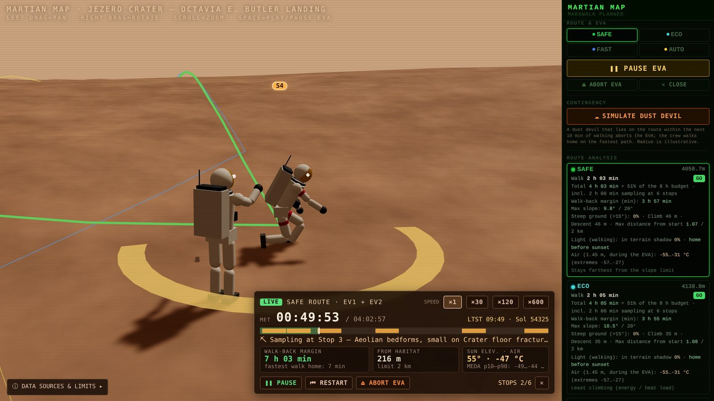
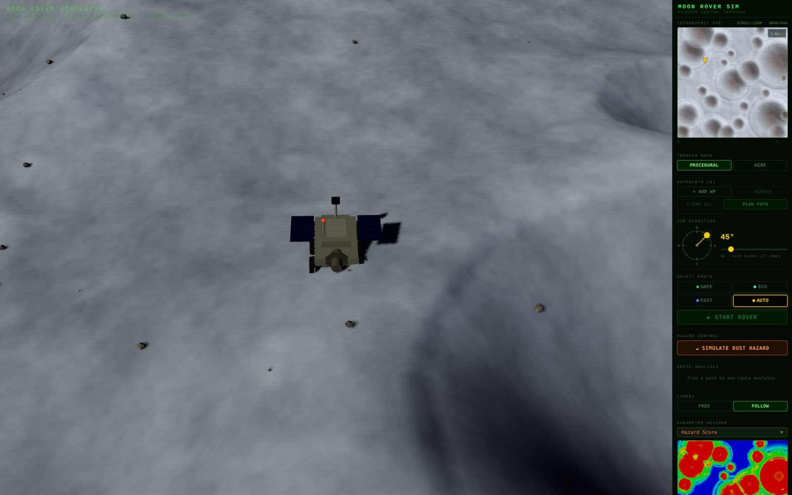
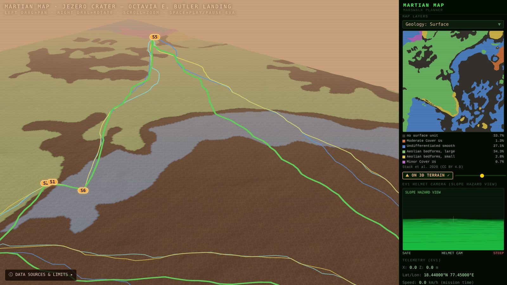
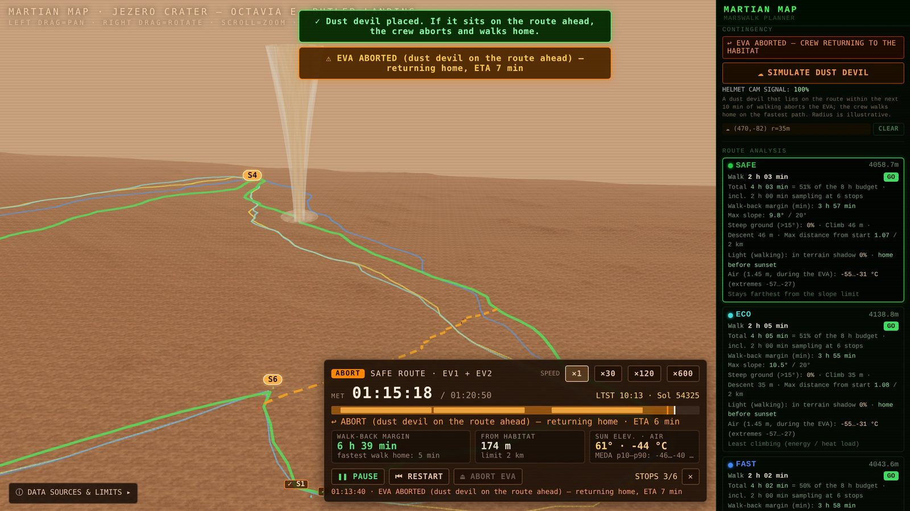

<p align="center">
  <a href="https://sayko89.github.io/tua-astro-hackathon/"></a>
</p>

<p align="center">
  <a href="https://sayko89.github.io/tua-astro-hackathon/"></a>
  
  
  <a href="https://github.com/sayko89/tua-astro-hackathon/actions/workflows/deploy-pages.yml"></a>
</p>

<p align="center"><b>Team PERIAPSIS</b> · built for the <b>TUA Astro Hackathon</b> (Turkish Space Agency) and extended for the NASA Space Apps Challenge 2026 <i>Interplanetary Survival Guide: Martian Map</i></p>

---

A crew on the Moon or Mars can only go as far as it can safely come back from. **Martian Map** is a mission planner and 3D simulator that answers that question on **real terrain**: it plans rover and astronaut routes across Jezero crater, picks the geology stops worth sampling, checks at every step that the crew can still walk home before their suits run out, and then plays the whole mission out in 3D.

It started as a **lunar rover mission simulator** for the TUA Astro Hackathon and grew into a Marswalk planner built on NASA and USGS data. Both live in the same app.



## Try it

| | |
|---|---|
| **Online** | **[sayko89.github.io/tua-astro-hackathon/](https://sayko89.github.io/tua-astro-hackathon/)** — nothing to install |
| **Offline** | **Code → Download ZIP** → unzip → `MartianMap/Start-Windows.bat` (Windows) or `MartianMap/start-mac-linux.sh` (macOS / Linux). Needs only Python 3. Opening `index.html` directly does not work: browsers block local data files and Web Workers. |
| **From source** | `pnpm install`, then `pnpm --filter moon-rover dev` |

**Quick tour:** press **PLAN SCIENCE EVA** → pick a route (SAFE / ECO / FAST / AUTO) and read its GO / NO-GO card → **START EVA** and follow the crew (×1 … ×600, **ABORT EVA**, **SIMULATE DUST DEVIL**) → **Map Layers → DRAPE ON 3D TERRAIN** to see geology, slope or EVA range on the terrain. Space bar plays and pauses the EVA.

## Two missions, one simulator

<table>
<tr>
<td width="50%" valign="top">

<h3>Moon Rover — <a href="https://sayko89.github.io/tua-astro-hackathon/?site=moon"><code>?site=moon</code></a></h3>
The original TUA Astro Hackathon build. A rover on procedural lunar terrain with craters, boulders and a moving sun. Place waypoints and the A* planner offers four routes (SAFE, ECO, FAST, AUTO) weighted by slope, hazard and sunlight. Heatmaps show hazard, slope and illumination; a simulated dust event tests the rover's return-to-home logic.
</td>
<td width="50%" valign="top">

<h3>Martian Map — <a href="https://sayko89.github.io/tua-astro-hackathon/">default</a></h3>
The same planner on a real place: Jezero crater around the Perseverance landing site. Real elevation, geology, sunlight and air temperature drive the routes, and a two-person crew walks the plan on a mission clock with a live walk-back margin.
</td>
</tr>
</table>

## The layers — all real data

| Layer | Source | Used for |
|---|---|---|
| Terrain, 4 m grid over 2 km | USGS Mars 2020 Terrain Relative Navigation HiRISE DTM mosaic (MRO HiRISE) | slopes, impassable walls, walking time, shadows |
| Geology (surface + bedrock units) | Mars 2020 science-team photogeologic map (Stack et al. 2020) | science stops, map layer |
| Air temperature at 1.45 m | Perseverance MEDA air-temperature sensors, one Mars year (Hueso et al. 2024) | expected temperature at the time the crew walks |
| Sun, local solar time, sunrise / sunset | Mars24 algorithm (NASA GISS; Allison & McEwen 2000) | light, terrain shadow and darkness along the route; mission clock |
| EVA limits | NASA xEVA System ConOps (2020): 20° slope, ~2 km/h, ≤ 8 h, ≤ 2 km | walls, speed, time budget, radius |
| Crew of two (EV1 + EV2) | NASA EVA Lunar Surface ConOps (2020) | the crew in the 3D scene |

## How a Marswalk is planned

1. **Science stops.** Candidates are the nearest interior point of every (surface, bedrock)
   unit pair and of every bedrock contact. Pairwise walking times come from Dijkstra; an exact
   subset DP (Held–Karp) picks the set and order of stops that maximises geologic diversity
   (distinct units sampled) while walking + time at stops stays within the 8 h budget.
2. **Routes.** A* on walking time: Tobler's slope–speed shape scaled to NASA's ~2 km/h level
   pace; cells steeper than 20° are walls. Four route preferences (SAFE, ECO, FAST, AUTO);
   reported times always use the same physical model.
3. **Walk-back margin.** Two Dijkstra maps give the fastest walk from home to every cell and
   back. At every point: *margin = budget − (time so far + fastest walk home)*. The first point
   with a negative margin is the **point of no return**. **GO** = margin ≥ 0 everywhere, never
   farther than 2 km from home, no slope above 20°.
4. **Conditions.** For the moment the crew actually walks each point: sun elevation, terrain
   shadow, darkness, home before sunset or not, and the expected air-temperature range.

## How it is carried out — EVA playback

- Two astronauts walk the plan on a mission clock (×1 … ×600). Positions come from the
  planner's own timeline, so what you see is exactly what the GO decision was based on.
- At each stop EV1 kneels and samples while EV2 documents; a flag marks every sampled stop.
- The HUD shows mission elapsed time, the current activity, the **live walk-back margin**,
  distance from the habitat, and the sun elevation and MEDA temperature at the mission time.
  Sun, sky and shadows move with the clock; helmet lights come on around sunset.
- **ABORT EVA** sends the crew home on the fastest path of the same Dijkstra map, so the abort
  ETA is exactly the return time the margin assumed. A **dust devil** on the route within the
  next 10 minutes of walking triggers an automatic abort.



## Verified, not just drawn

`node --test artifacts/moon-rover/tests/*.test.mjs` (37 tests) and
`python -m unittest discover pipeline/tests` (3 tests):

- **Sun:** USGS reference values, 60 random epochs against `marstime`, an independent vector
  geometry check, and the MEDA team's sunset table (largest difference 0.25 min over 700 sols).
- **Terrain & routes:** shadow length = height / tan(sun elevation); A* reaches the Dijkstra
  optimum in every mode; the walk-back maps equal A* times in both directions.
- **Data:** `climate.json` and `geology.json` match independent recomputations from the
  original Zenodo and journal files.
- **Planning & playback:** the stop optimiser equals brute force on 40 random cases; the
  playback timeline equals the planner's round trip; the abort path time equals the Dijkstra
  return time; a dust devil ahead aborts the EVA before the crew reaches it.

## Honest limits

- The EVA limits are lunar values. NASA found a suited walk-back at Mars gravity not acceptable
  (TP-2009-214796), so they are optimistic for Mars. The app says so.
- How slope changes suited walking speed is an assumption (Tobler shape).
- Time per stop (20 min by default) and the science-score weights are design choices.
- A 4 m grid cannot show rocks or ripples; shadows come only from terrain inside the 2 km site.
- Temperatures are a one-Mars-year climatology, not a forecast. The dust-devil size is illustrative.

## Data & credits

- USGS Astrogeology (2020). *Mars 2020 Terrain Relative Navigation HiRISE DTM Mosaic.* [doi:10.5066/P9REJ9JN](https://doi.org/10.5066/P9REJ9JN)
- Stack, K. M., et al. (2020). *Photogeologic map of the Perseverance rover field site in Jezero crater constructed by the Mars 2020 Science Team.* Space Sci. Rev. 216, 127. [doi:10.1007/s11214-020-00739-x](https://doi.org/10.1007/s11214-020-00739-x) (CC BY 4.0)
- Hueso, R., et al. (2024). *Derived environmental temperatures at Jezero crater from Air Temperature Sensors' measurements on the Perseverance rover* (v2). Zenodo. [doi:10.5281/zenodo.11198655](https://doi.org/10.5281/zenodo.11198655) (CC BY 4.0)
- Allison, M. & McEwen, M. (2000). *A post-Pathfinder evaluation of areocentric solar coordinates with improved timing recipes for Mars seasonal/diurnal climate studies.* Planet. Space Sci. 48 — the Mars24 algorithm, NASA GISS.
- NASA EVA-EXP-0042 Rev B (2020). *Exploration EVA System Concept of Operations.* NASA (2020). *EVA Lunar Surface Concept of Operations.* Norcross, J., et al. (2009). NASA/TP-2009-214796.
- Tobler, W. (1993). *Three presentations on geographical analysis and modeling.* NCGIA Technical Report 93-1.

## Use of AI

Developed with AI assistance (Anthropic Claude) for code, data pipelines, tests and
documentation, under the team's direction and review. All data come from the sources above.
The astronauts, dust devil and other 3D objects are original procedural models written in code;
no AI-generated images are used. The demo video is a screen capture of the running app.

## Repository map

```
artifacts/moon-rover/     the web app (React + Three.js / react-three-fiber, Vite)
  src/utils/              walkModel · pathfinder (A*) · walkback (Dijkstra, abort path) · science (stop optimiser)
                          marsTime (Mars24) · shadows · climate · evaTimeline + evaPlayback (EVA playback)
  src/components/         MoonScene (3D) · MarsCrew (astronauts) · EvaHud · RightPanel
  public/sites/jezero/    terrain, geology and climate data the app loads
  tests/                  node --test suites
pipeline/                 build_site.py (terrain) · build_climate.py (MEDA) · build_geology.py (map) · build_offline.py
MartianMap/               ready-to-run offline package
artifacts/api-server/     Express API scaffold · lib/: shared OpenAPI / Zod / DB packages (pnpm workspace)
tools/dev-setup/          Windows scripts for the team's development agents
```

## Rebuilding the data

The processed data are committed, so the app runs as is. To regenerate them:

```bash
pip install -r pipeline/requirements.txt
python pipeline/build_site.py       # terrain: reads only the needed window of the 1.8 GB HiRISE DTM over HTTP range requests
python pipeline/build_climate.py    # air temperature: MEDA ATS, downloads 22.7 MB once
python pipeline/build_geology.py    # geology: Mars 2020 photogeologic map, downloads 3.5 MB once
python pipeline/build_offline.py    # refresh MartianMap/app after changing the app
```

`build_site.py` resamples the equirectangular DTM to a true-scale local projection at the site centre, so slopes are correct (east–west scale would otherwise be ~5% off at Jezero's latitude). Options: `--grid`, `--cell`, `--lat/--lon`, `--src <local GeoTIFF>`.

## License

MIT
